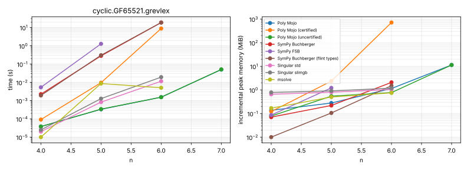

# Gröbner basis pilot results

Host: Intel(R) Xeon(R) Processor @ 2.10GHz, 4 vCPUs (KVM), 16 GiB RAM, Ubuntu 24.04.5 LTS, Linux 6.18.44-fc-v139. Every run is pinned to one CPU and single-threaded, capped at 9G of memory and 900 s.

Versions: Poly Mojo fdba30fb4669; Poly Mojo (certified) fdba30fb4669; Poly Mojo (uncertified) fdba30fb4669; SymPy Buchberger 1.14.0 (gmpy ground types); SymPy F5B 1.14.0 (gmpy ground types); SymPy Buchberger (flint types) 1.14.0 (flint ground types); SymPy FGLM 1.14.0 (gmpy ground types); Singular std 4.4.1; Singular slimgb 4.4.1; Singular modStd 4.4.1; Singular stdfglm 4.4.1; msolve 0.11.0.

Records: 39 (28 ok, 2 timeout, 9 unsupported).

## Summary

Ratios cover cases that both tools solved with a confirmed answer and on which the slower of the two took at least 10 ms (memory: at least 1 MiB). Poly Mojo runs in comparable mode (no witnesses).

**Time** (geometric mean of competitor ÷ Poly Mojo; above 1 means Poly Mojo used less; *n* = cases compared)

| Field, order | SymPy Buchberger | SymPy F5B | SymPy Buchberger (flint types) | SymPy FGLM | Singular std | Singular slimgb | Singular modStd | Singular stdfglm | msolve |
|---|---|---|---|---|---|---|---|---|---|
| GF(65521), grevlex | 3.21e+03 (*n* = 2) | 3.85e+03 (*n* = 1) | 3.33e+03 (*n* = 2) | — | 7.44 (*n* = 1) | 12.5 (*n* = 1) | — | — | — |

**Incremental peak memory** (geometric mean of competitor ÷ Poly Mojo; above 1 means Poly Mojo used less; *n* = cases compared)

| Field, order | SymPy Buchberger | SymPy F5B | SymPy Buchberger (flint types) | SymPy FGLM | Singular std | Singular slimgb | Singular modStd | Singular stdfglm | msolve |
|---|---|---|---|---|---|---|---|---|---|
| GF(65521), grevlex | 1.82 (*n* = 1) | 4.38 (*n* = 1) | 1.31 (*n* = 1) | — | 0.911 (*n* = 1) | 1.03 (*n* = 1) | — | — | 0.655 (*n* = 1) |

**Solved cases** (finished within the limits with an answer no other library contradicts):

| Field, order | Poly Mojo | Poly Mojo (certified) | Poly Mojo (uncertified) | SymPy Buchberger | SymPy F5B | SymPy Buchberger (flint types) | SymPy FGLM | Singular std | Singular slimgb | Singular modStd | Singular stdfglm | msolve |
|---|---|---|---|---|---|---|---|---|---|---|---|---|
| GF(65521), grevlex | 4/4 | 3/4 | 4/4 | 3/4 | 2/4 | 3/4 | n/a | 3/4 | 3/4 | n/a | n/a | 3/4 |

## Answer agreement

Every answer that two or more libraries computed agrees.

Answers computed by only one library (marked ? in the tables): cyclic-7.GF65521.grevlex.

## Certification overhead

Comparable mode computes without witnesses. Certified mode retains cofactor rows and runs `sparse.check_groebner`, which verifies both ideal containments and the Buchberger criterion.

| Case | Comparable | Certified compute | Check | Certified peak ÷ comparable peak |
|---|---|---|---|---|
| cyclic-6.GF65521.grevlex | 1.54 ms | 8.82 s | 5.27 s | 622 |

## Per-ladder results

Each cell gives the median time per call and the incremental peak memory. `·` marks an instance skipped after a smaller one on the same ladder hit a limit; `n/a` marks an unsupported order or field.

#### cyclic-n over GF(65521), grevlex

| n | vars | Poly Mojo | Poly Mojo (certified) | Poly Mojo (uncertified) | SymPy Buchberger | SymPy F5B | SymPy Buchberger (flint types) | SymPy FGLM | Singular std | Singular slimgb | Singular modStd | Singular stdfglm | msolve |
|---|---|---|---|---|---|---|---|---|---|---|---|---|---|
| 4 | 4 | < 1 ms < 1 MiB | < 1 ms < 1 MiB | < 1 ms < 1 MiB | 2.24 ms < 1 MiB | 5.33 ms < 1 MiB | 1.91 ms < 1 MiB | n/a | < 1 ms < 1 MiB | < 1 ms < 1 MiB | n/a | n/a | < 1 ms < 1 MiB |
| 5 | 5 | < 1 ms < 1 MiB | 9.55 ms 2.36 MiB | < 1 ms < 1 MiB | 280 ms < 1 MiB | 1.28 s 1.21 MiB | 304 ms < 1 MiB | n/a | < 1 ms < 1 MiB | 1.28 ms < 1 MiB | n/a | n/a | 8.57 ms < 1 MiB |
| 6 | 6 | 1.54 ms 1.14 MiB | 8.82 s 712 MiB | 1.53 ms < 1 MiB | 18.8 s 2.08 MiB | timeout | 18.7 s 1.5 MiB | n/a | 11.5 ms 1.04 MiB | 19.2 ms 1.18 MiB | n/a | n/a | 5.03 ms < 1 MiB |
| 7 | 7 | 49.7 ms 11.4 MiB ? | timeout | 50.9 ms 11.3 MiB ? |  |  |  |  |  |  |  |  |  |

## Plots

