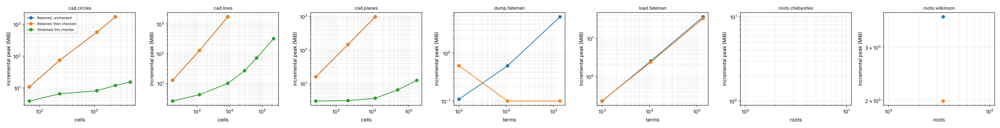

# Streaming study

Host: Intel(R) Xeon(R) Processor @ 2.10GHz, 4 vCPUs, 16 GiB RAM. Runs are pinned to one CPU, capped at 3G and 600 s. Poly Mojo fdba30fb4669.

Each cell gives wall time and the incremental peak resident memory of the measured work: the high-water mark from just before the call to its end, minus the resident size before it. Both checked routes establish the same claim; the streamed route never holds the complete output.

### CAD of k random lines (`cad.decompose` + `cad.check` against `cad.decompose_to` + `cad.checker`)

| size | cells | Retained, unchecked | Retained, then checked | Streamed into checker | checked peak ÷ streamed peak |
|---|---|---|---|---|---|
| 4 | 177 | 35.4 ms 12.7 MiB | 48.4 ms 12.7 MiB | 65.6 ms 2.54 MiB | 5.03× |
| 8 | 1,185 | 347 ms 128 MiB | 532 ms 128 MiB | 571 ms 4.16 MiB | 30.8× |
| 16 | 8,769 | 4.32 s 1.71 GiB | 7.86 s 1.71 GiB | 7.01 s 10 MiB | 175× |
| 24 | 28,799 | OOM | OOM | 33.2 s 26.8 MiB | checked route: OOM |
| 32 | 67,193 | · | · | 100 s 71.8 MiB | checked route: · |
| 48 | 223,077 | · | · | 502 s 321 MiB | checked route: · |
| 64 |  | · | · | timeout |  |

### CAD of k random circles

| size | cells | Retained, unchecked | Retained, then checked | Streamed into checker | checked peak ÷ streamed peak |
|---|---|---|---|---|---|
| 2 | 65 | 84.2 ms 10.9 MiB | 125 ms 10.7 MiB | 149 ms 3.89 MiB | 2.76× |
| 4 | 233 | 1.47 s 74.6 MiB | 2.28 s 73.8 MiB | 2.52 s 6.57 MiB | 11.2× |
| 6 | 1,115 | 19.8 s 566 MiB | 29.3 s 566 MiB | 32 s 8.22 MiB | 68.9× |
| 8 | 2,437 | 71.3 s 1.67 GiB | 101 s 1.67 GiB | 98.9 s 12 MiB | 142× |
| 12 | 4,571 | OOM | OOM | 295 s 15.3 MiB | checked route: OOM |
| 16 |  | · | · | timeout |  |

### CAD of k random planes in three variables

| size | cells | Retained, unchecked | Retained, then checked | Streamed into checker | checked peak ÷ streamed peak |
|---|---|---|---|---|---|
| 2 | 277 | 38.7 ms 16 MiB | 63.5 ms 15.9 MiB | 70.5 ms 3.02 MiB | 5.27× |
| 3 | 2,143 | 386 ms 147 MiB | 682 ms 147 MiB | 572 ms 3.12 MiB | 47× |
| 4 | 11,945 | 2.75 s 977 MiB | 4.76 s 977 MiB | 4.15 s 3.67 MiB | 266× |
| 5 | 49,831 | OOM | OOM | 21 s 6.51 MiB | checked route: OOM |
| 6 | 166,357 | · | · | 80.5 s 12.5 MiB | checked route: · |
| 8 |  | · | · | timeout |  |

### Real roots of the Wilkinson polynomial of degree n to 64 bits (`real_root_cover` + `roots.check` against `real_root_cover_to` + checker)

| size | roots | Retained, unchecked | Retained, then checked | Streamed into checker | checked peak ÷ streamed peak |
|---|---|---|---|---|---|
| 50 | 3,474 | n/a | 70.2 ms 3.79 MiB | 1.24 s 1.99 MiB | 1.9× |
| 100 |  | n/a | error | error |  |
| 200 |  | n/a | error | error |  |
| 400 |  | n/a | error | timeout |  |
| 800 |  | n/a | error | · |  |
| 1600 |  | n/a | error | · |  |

### Real roots of the Chebyshev polynomial T_n to 64 bits

| size | roots | Retained, unchecked | Retained, then checked | Streamed into checker | checked peak ÷ streamed peak |
|---|---|---|---|---|---|
| 100 |  | n/a | error | error |  |
| 200 |  | n/a | error | error |  |
| 400 |  | n/a | error | error |  |
| 800 |  | n/a | error | error |  |
| 1600 |  | n/a | error | timeout |  |
| 3200 |  | n/a | error | · |  |

### Write (1 + x + y + z + t)^n as text (`sparse.dumps` to a file against `sparse.dump` into a file sink)

| size | terms | Retained, unchecked | Retained, then checked | Streamed into checker | checked peak ÷ streamed peak |
|---|---|---|---|---|---|
| 10 | 1,001 | n/a | < 1 ms < 1 MiB | < 1 ms < 1 MiB | 0.2× |
| 20 | 10,626 | n/a | 4.61 ms < 1 MiB | 4.39 ms < 1 MiB | 6.04× |
| 40 | 135,751 | n/a | 121 ms 5.72 MiB | 122 ms < 1 MiB |  |
| 60 |  | n/a | timeout | timeout |  |
| 80 |  | n/a | · | · |  |

### Read (1 + x + y + z + t)^n back (`sparse.loads` of the whole file against `sparse.load` from a file source)

| size | terms | Retained, unchecked | Retained, then checked | Streamed into checker | checked peak ÷ streamed peak |
|---|---|---|---|---|---|
| 10 | 1,001 | n/a | 1.13 ms < 1 MiB | 1.19 ms < 1 MiB | 0.983× |
| 20 | 10,626 | n/a | 14.8 ms 2.55 MiB | 16.3 ms 2.38 MiB | 1.07× |
| 40 | 135,751 | n/a | 356 ms 37 MiB | 307 ms 33.5 MiB | 1.1× |
| 60 |  | n/a | timeout | timeout |  |
| 80 |  | n/a | · | · |  |

