# Gröbner basis pilot results

> **Certified-mode run on claude/exp-qq-trace c5bbd8d, 2026-10-21** (wave 6 task 5). Scope: grevlex ladders over QQ and GF(65521) only; tools Poly Mojo (comparable), Poly Mojo (certified) and msolve; 60 s limit and 9G cap for every case; one process per case, at least 3 repetitions and 0.5 s. Compare with 2026-10-21-groebner (nightly d1f992f), where certified mode solved 25/44 QQ and 34/44 GF grevlex cases.
> - Certified mode now builds the QQ basis from its trace (exact replay, then inputs, S-pairs and reducedness checked), and `check_groebner` replays the trace and calls `check_groebner_basis`.
> - msolve is timed as a whole process less a baseline, so its sub-20 ms times are noisy; with both tools at 10 ms or more, msolve/certified over QQ is 0.506 (n = 20), and 0.265 (n = 9) with both at 0.1 s or more.

Host: Intel(R) Xeon(R) Processor @ 2.10GHz, 4 vCPUs (KVM), 16 GiB RAM, Ubuntu 24.04.5 LTS, Linux 6.18.44-fc-v140. Every run is pinned to one CPU and single-threaded, capped at 9G of memory and 60 s.

Versions: Poly Mojo c5bbd8d66f1d; Poly Mojo (certified) c5bbd8d66f1d; msolve 0.11.0.

Records: 264 (229 ok, 15 skipped, 20 timeout).

## Summary

Ratios cover cases that both tools solved with a confirmed answer and on which the slower of the two took at least 10 ms (memory: at least 1 MiB). Poly Mojo runs in comparable mode (no witnesses).

**Time** (geometric mean of competitor ÷ Poly Mojo; above 1 means Poly Mojo used less; *n* = cases compared)

| Field, order | msolve |
|---|---|
| GF(65521), grevlex | 7.2 (*n* = 31) |
| QQ, grevlex | 1.47 (*n* = 30) |

**Incremental peak memory** (geometric mean of competitor ÷ Poly Mojo; above 1 means Poly Mojo used less; *n* = cases compared)

| Field, order | msolve |
|---|---|
| GF(65521), grevlex | 0.353 (*n* = 26) |
| QQ, grevlex | 0.351 (*n* = 29) |

**Solved cases** (finished within the limits with an answer no other library contradicts):

| Field, order | Poly Mojo | Poly Mojo (certified) | msolve |
|---|---|---|---|
| GF(65521), grevlex | 42/44 | 40/44 | 42/44 |
| QQ, grevlex | 35/44 | 32/44 | 38/44 |

## Answer agreement

Every answer that two or more libraries computed agrees.

Answers computed by only one library (marked ? in the tables): cyclic-8.QQ.grevlex, katsura-10.QQ.grevlex, randquad-8.QQ.grevlex.

## Certification overhead

Comparable mode computes without witnesses. Certified mode retains cofactor rows and runs `sparse.check_groebner`, which verifies both ideal containments and the Buchberger criterion.

| Case | Comparable | Certified compute | Check | Certified peak ÷ comparable peak |
|---|---|---|---|---|
| cyclic-7.GF65521.grevlex | 43.4 ms | 122 ms | 127 ms | 2.29 |
| cyclic-8.GF65521.grevlex | 762 ms | 2.54 s | 3.01 s | 3.98 |
| cyclic-6.QQ.grevlex | 15.2 ms | 50.8 ms | 18.8 ms | 1.35 |
| cyclic-7.QQ.grevlex | 1.26 s | 15.7 s | 10.4 s | 2.04 |
| eco-9.GF65521.grevlex | 9.73 ms | 18.6 ms | 25.5 ms | 2.32 |
| eco-10.GF65521.grevlex | 38.6 ms | 113 ms | 175 ms | 2.56 |
| eco-11.GF65521.grevlex | 212 ms | 704 ms | 922 ms | 3.25 |
| eco-12.GF65521.grevlex | 1.46 s | 5.38 s | 7.11 s | 6.7 |
| eco-7.QQ.grevlex | 6.32 ms | 13.1 ms | 5.39 ms | 1.43 |
| eco-8.QQ.grevlex | 28.8 ms | 46.6 ms | 23.3 ms | 1.09 |
| eco-9.QQ.grevlex | 116 ms | 253 ms | 119 ms | 1.36 |
| eco-10.QQ.grevlex | 802 ms | 1.5 s | 931 ms | 1.56 |
| eco-11.QQ.grevlex | 5.41 s | 11.1 s | 8.16 s | 1.62 |
| katsura-7.GF65521.grevlex | 4.74 ms | 10.6 ms | 14.4 ms | 1.72 |
| katsura-8.GF65521.grevlex | 22.9 ms | 73.9 ms | 85.8 ms | 2.13 |
| katsura-9.GF65521.grevlex | 139 ms | 526 ms | 534 ms | 2.47 |
| katsura-10.GF65521.grevlex | 1.1 s | 3.7 s | 4.25 s | 3.2 |
| katsura-6.QQ.grevlex | 13.1 ms | 34.1 ms | 18.6 ms | 1.61 |
| katsura-7.QQ.grevlex | 80.3 ms | 197 ms | 115 ms | 1.37 |
| katsura-8.QQ.grevlex | 591 ms | 1.26 s | 793 ms | 1.77 |
| katsura-9.QQ.grevlex | 4.78 s | 10.1 s | 7.2 s | 2 |
| noon-6.GF65521.grevlex | 14.9 ms | 17.9 ms | 20.5 ms | 1.37 |
| noon-7.GF65521.grevlex | 94.6 ms | 126 ms | 147 ms | 1.3 |
| noon-8.GF65521.grevlex | 750 ms | 991 ms | 1.23 s | 2.05 |
| noon-9.GF65521.grevlex | 7.04 s | 7.79 s | 8.89 s | 2.59 |
| noon-5.QQ.grevlex | 16.4 ms | 20.3 ms | 8.44 ms | 1.18 |
| noon-6.QQ.grevlex | 55.2 ms | 135 ms | 47.5 ms | 1.52 |
| noon-7.QQ.grevlex | 345 ms | 820 ms | 301 ms | 1.71 |
| noon-8.QQ.grevlex | 2.89 s | 6.81 s | 2.11 s | 1.46 |
| randquad-8.GF65521.grevlex | 16.4 ms | 59.7 ms | 105 ms | 1.71 |
| randquad-9.GF65521.grevlex | 95.8 ms | 316 ms | 454 ms | 2.01 |
| randquad-10.GF65521.grevlex | 746 ms | 2.47 s | 3.28 s | 2.34 |
| randquad-4.QQ.grevlex | 8 ms | 12.8 ms | 6.35 ms | 1.21 |
| randquad-5.QQ.grevlex | 55 ms | 97.9 ms | 48.6 ms | 1.08 |
| randquad-6.QQ.grevlex | 527 ms | 1.84 s | 754 ms | 1.25 |
| reimer-6.GF65521.grevlex | 25 ms | 39.2 ms | 54 ms | 1.33 |
| reimer-5.QQ.grevlex | 70.2 ms | 36.3 ms | 21.6 ms | 0.48 |
| reimer-6.QQ.grevlex | 6.53 s | 378 ms | 247 ms | 0.173 |

## Per-ladder results

Each cell gives the median time per call and the incremental peak memory. `·` marks an instance skipped after a smaller one on the same ladder hit a limit; `n/a` marks an unsupported order or field.

#### cyclic-n over GF(65521), grevlex

| n | vars | Poly Mojo | Poly Mojo (certified) | msolve |
|---|---|---|---|---|
| 4 | 4 | < 1 ms < 1 MiB | < 1 ms < 1 MiB | < 1 ms < 1 MiB |
| 5 | 5 | < 1 ms < 1 MiB | < 1 ms < 1 MiB | < 1 ms < 1 MiB |
| 6 | 6 | 1.73 ms 1.14 MiB | 2.42 ms 2.11 MiB | 3.27 ms < 1 MiB |
| 7 | 7 | 43.4 ms 11.4 MiB | 122 ms 26.1 MiB | 127 ms 3.36 MiB |
| 8 | 8 | 762 ms 54.1 MiB | 2.54 s 215 MiB | 2.1 s 25.4 MiB |
| 9 | 9 | timeout | timeout | timeout |

#### eco-n over GF(65521), grevlex

| n | vars | Poly Mojo | Poly Mojo (certified) | msolve |
|---|---|---|---|---|
| 5 | 5 | < 1 ms < 1 MiB | < 1 ms < 1 MiB | 5.08 ms < 1 MiB |
| 6 | 6 | < 1 ms < 1 MiB | < 1 ms < 1 MiB | 18.8 ms < 1 MiB |
| 7 | 7 | < 1 ms < 1 MiB | 1.02 ms < 1 MiB | < 1 ms < 1 MiB |
| 8 | 8 | 2.93 ms 1.61 MiB | 3.96 ms 2.63 MiB | 22 ms < 1 MiB |
| 9 | 9 | 9.73 ms 4.53 MiB | 18.6 ms 10.5 MiB | 39.7 ms 1.25 MiB |
| 10 | 10 | 38.6 ms 11.1 MiB | 113 ms 28.4 MiB | 121 ms 2.76 MiB |
| 11 | 11 | 212 ms 30.4 MiB | 704 ms 99 MiB | 737 ms 10.4 MiB |
| 12 | 12 | 1.46 s 86.6 MiB | 5.38 s 581 MiB | 5.12 s 36.5 MiB |
| 13 | 13 | 9.58 s 283 MiB | timeout | 36 s 162 MiB |

#### katsura-n over GF(65521), grevlex

| n | vars | Poly Mojo | Poly Mojo (certified) | msolve |
|---|---|---|---|---|
| 3 | 4 | < 1 ms < 1 MiB | < 1 ms < 1 MiB | 9.93 ms < 1 MiB |
| 4 | 5 | < 1 ms < 1 MiB | < 1 ms < 1 MiB | 21.5 ms < 1 MiB |
| 5 | 6 | < 1 ms < 1 MiB | < 1 ms < 1 MiB | 9.96 ms < 1 MiB |
| 6 | 7 | 1.3 ms 1.11 MiB | 2.09 ms 1.92 MiB | < 1 ms < 1 MiB |
| 7 | 8 | 4.74 ms 2.62 MiB | 10.6 ms 4.5 MiB | 36.3 ms 1 MiB |
| 8 | 9 | 22.9 ms 8.62 MiB | 73.9 ms 18.3 MiB | 78.2 ms 2.25 MiB |
| 9 | 10 | 139 ms 25.2 MiB | 526 ms 62.3 MiB | 383 ms 5.88 MiB |
| 10 | 11 | 1.1 s 81.2 MiB | 3.7 s 260 MiB | 2.65 s 22.4 MiB |
| 11 | 12 | 7.4 s 259 MiB | timeout | 20.6 s 91.3 MiB |
| 12 | 13 | timeout | · | timeout |

#### noon-n over GF(65521), grevlex

| n | vars | Poly Mojo | Poly Mojo (certified) | msolve |
|---|---|---|---|---|
| 3 | 3 | < 1 ms < 1 MiB | < 1 ms < 1 MiB | 2.22 ms < 1 MiB |
| 4 | 4 | < 1 ms < 1 MiB | < 1 ms < 1 MiB | 19.3 ms < 1 MiB |
| 5 | 5 | 2.46 ms 1.68 MiB | 2.95 ms 1.74 MiB | 25.4 ms < 1 MiB |
| 6 | 6 | 14.9 ms 4.84 MiB | 17.9 ms 6.65 MiB | 55.3 ms 1.5 MiB |
| 7 | 7 | 94.6 ms 20.8 MiB | 126 ms 26.9 MiB | 205 ms 6.04 MiB |
| 8 | 8 | 750 ms 66.9 MiB | 991 ms 137 MiB | 1.45 s 35 MiB |
| 9 | 9 | 7.04 s 426 MiB | 7.79 s 1.08 GiB | 12 s 188 MiB |

#### randquad-n over GF(65521), grevlex

| n | vars | Poly Mojo | Poly Mojo (certified) | msolve |
|---|---|---|---|---|
| 3 | 3 | < 1 ms < 1 MiB | < 1 ms < 1 MiB | < 1 ms < 1 MiB |
| 4 | 4 | < 1 ms < 1 MiB | < 1 ms < 1 MiB | 25.4 ms < 1 MiB |
| 5 | 5 | < 1 ms < 1 MiB | < 1 ms < 1 MiB | 20.9 ms < 1 MiB |
| 6 | 6 | 1.12 ms < 1 MiB | 1.72 ms 1.57 MiB | 24.2 ms < 1 MiB |
| 7 | 7 | 3.82 ms 2.39 MiB | 7.83 ms 3.98 MiB | 41.2 ms < 1 MiB |
| 8 | 8 | 16.4 ms 6.52 MiB | 59.7 ms 11.1 MiB | 77 ms 1.75 MiB |
| 9 | 9 | 95.8 ms 22 MiB | 316 ms 44.1 MiB | 313 ms 5.37 MiB |
| 10 | 10 | 746 ms 68.2 MiB | 2.47 s 159 MiB | 1.93 s 18.1 MiB |

#### reimer-n over GF(65521), grevlex

| n | vars | Poly Mojo | Poly Mojo (certified) | msolve |
|---|---|---|---|---|
| 3 | 3 | < 1 ms < 1 MiB | < 1 ms < 1 MiB | 8.16 ms < 1 MiB |
| 4 | 4 | < 1 ms < 1 MiB | < 1 ms 1.02 MiB | 24.1 ms < 1 MiB |
| 5 | 5 | 3.19 ms 1.51 MiB | 3.54 ms 2.18 MiB | 25.1 ms < 1 MiB |
| 6 | 6 | 25 ms 6.65 MiB | 39.2 ms 8.83 MiB | 78.5 ms 2.5 MiB |

#### cyclic-n over QQ, grevlex

| n | vars | Poly Mojo | Poly Mojo (certified) | msolve |
|---|---|---|---|---|
| 4 | 4 | 1.1 ms < 1 MiB | 1.63 ms < 1 MiB | < 1 ms < 1 MiB |
| 5 | 5 | 3.27 ms 1.46 MiB | 7.13 ms 1.65 MiB | < 1 ms < 1 MiB |
| 6 | 6 | 15.2 ms 3.14 MiB | 50.8 ms 4.23 MiB | 20.6 ms 1.5 MiB |
| 7 | 7 | 1.26 s 53.3 MiB | 15.7 s 109 MiB | 840 ms 10.2 MiB |
| 8 | 8 | timeout | timeout | 20.1 s 63.8 MiB ? |
| 9 | 9 | · | · | timeout |

#### eco-n over QQ, grevlex

| n | vars | Poly Mojo | Poly Mojo (certified) | msolve |
|---|---|---|---|---|
| 5 | 5 | 1.69 ms < 1 MiB | 2.59 ms 1.12 MiB | 16.2 ms < 1 MiB |
| 6 | 6 | 2.84 ms 1.07 MiB | 4.9 ms 1.48 MiB | 21.1 ms < 1 MiB |
| 7 | 7 | 6.32 ms 1.64 MiB | 13.1 ms 2.34 MiB | 18.4 ms < 1 MiB |
| 8 | 8 | 28.8 ms 4.63 MiB | 46.6 ms 5.07 MiB | 32.9 ms 1.94 MiB |
| 9 | 9 | 116 ms 12.9 MiB | 253 ms 17.5 MiB | 79.1 ms 3.41 MiB |
| 10 | 10 | 802 ms 36.4 MiB | 1.5 s 56.8 MiB | 390 ms 9.1 MiB |
| 11 | 11 | 5.41 s 125 MiB | 11.1 s 202 MiB | 2.69 s 37.9 MiB |
| 12 | 12 | 37.9 s 450 MiB | timeout | 18.5 s 162 MiB |
| 13 | 13 | timeout | · | timeout |

#### katsura-n over QQ, grevlex

| n | vars | Poly Mojo | Poly Mojo (certified) | msolve |
|---|---|---|---|---|
| 3 | 4 | 1.23 ms < 1 MiB | 1.98 ms < 1 MiB | 15.7 ms < 1 MiB |
| 4 | 5 | 2.03 ms < 1 MiB | 3.85 ms 1.58 MiB | 26.4 ms < 1 MiB |
| 5 | 6 | 4.21 ms 1.37 MiB | 8.73 ms 2.1 MiB | 19.6 ms < 1 MiB |
| 6 | 7 | 13.1 ms 2.42 MiB | 34.1 ms 3.89 MiB | 38.9 ms < 1 MiB |
| 7 | 8 | 80.3 ms 7.55 MiB | 197 ms 10.4 MiB | 61 ms 2.69 MiB |
| 8 | 9 | 591 ms 25.5 MiB | 1.26 s 45.1 MiB | 325 ms 8.41 MiB |
| 9 | 10 | 4.78 s 88.6 MiB | 10.1 s 177 MiB | 1.86 s 37.4 MiB |
| 10 | 11 | timeout | timeout | 13.9 s 145 MiB ? |
| 11 | 12 | · | · | timeout |
| 12 | 13 | · | · | · |

#### noon-n over QQ, grevlex

| n | vars | Poly Mojo | Poly Mojo (certified) | msolve |
|---|---|---|---|---|
| 3 | 3 | 1.39 ms 1 MiB | 1.92 ms 1.24 MiB | < 1 ms < 1 MiB |
| 4 | 4 | 3.14 ms 1.38 MiB | 4.77 ms 1.32 MiB | 41 ms < 1 MiB |
| 5 | 5 | 16.4 ms 2.85 MiB | 20.3 ms 3.37 MiB | 34.3 ms < 1 MiB |
| 6 | 6 | 55.2 ms 8.75 MiB | 135 ms 13.3 MiB | 88.8 ms 4.16 MiB |
| 7 | 7 | 345 ms 33.2 MiB | 820 ms 56.9 MiB | 474 ms 21.2 MiB |
| 8 | 8 | 2.89 s 195 MiB | 6.81 s 285 MiB | 3.13 s 130 MiB |
| 9 | 9 | 22.1 s 1 GiB | timeout | 22.1 s 642 MiB |

#### randquad-n over QQ, grevlex

| n | vars | Poly Mojo | Poly Mojo (certified) | msolve |
|---|---|---|---|---|
| 3 | 3 | 2.84 ms < 1 MiB | 2.78 ms < 1 MiB | 5.71 ms < 1 MiB |
| 4 | 4 | 8 ms 1.38 MiB | 12.8 ms 1.66 MiB | 35.1 ms < 1 MiB |
| 5 | 5 | 55 ms 3.78 MiB | 97.9 ms 4.07 MiB | 108 ms 1.43 MiB |
| 6 | 6 | 527 ms 12.5 MiB | 1.84 s 15.7 MiB | 462 ms 3.32 MiB |
| 7 | 7 | 9.12 s 47.1 MiB | timeout | 3.22 s 19.2 MiB |
| 8 | 8 | timeout | · | 35.7 s 165 MiB ? |
| 9 | 9 | · | · | timeout |
| 10 | 10 | · | · | · |

#### reimer-n over QQ, grevlex

| n | vars | Poly Mojo | Poly Mojo (certified) | msolve |
|---|---|---|---|---|
| 3 | 3 | 1.59 ms < 1 MiB | 2.14 ms 1.19 MiB | < 1 ms < 1 MiB |
| 4 | 4 | 5.7 ms 1.57 MiB | 6.89 ms 1.77 MiB | 25.5 ms < 1 MiB |
| 5 | 5 | 70.2 ms 9.07 MiB | 36.3 ms 4.35 MiB | 45.5 ms 1.41 MiB |
| 6 | 6 | 6.53 s 139 MiB | 378 ms 24 MiB | 227 ms 5.79 MiB |

## Plots

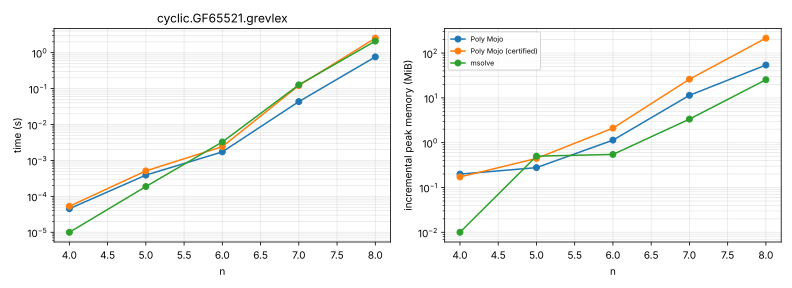
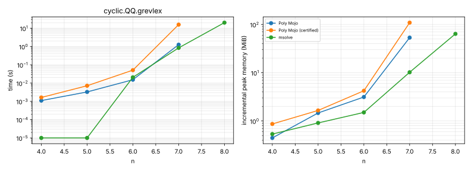
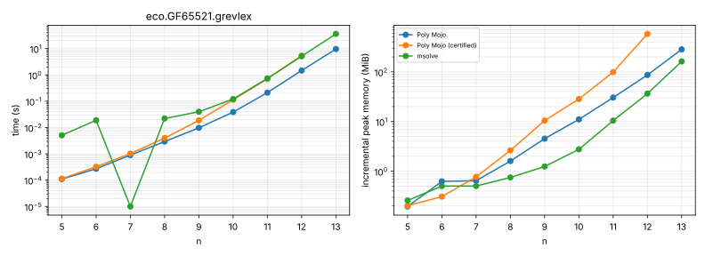
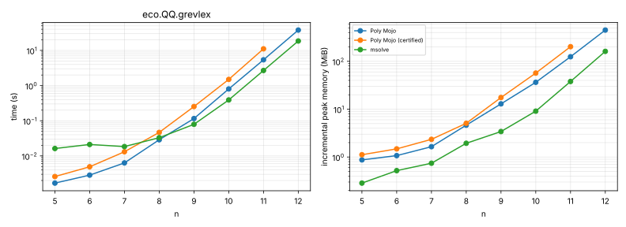
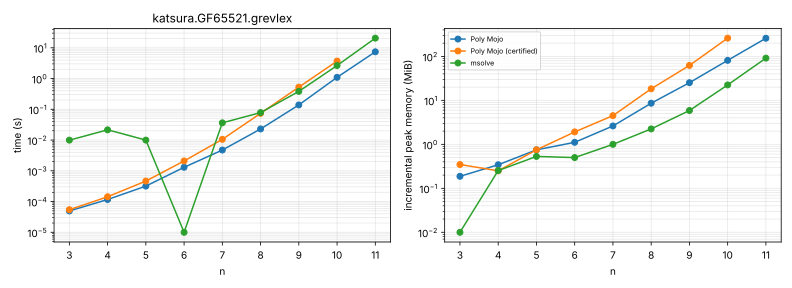
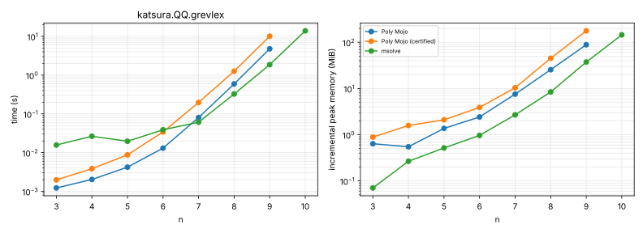
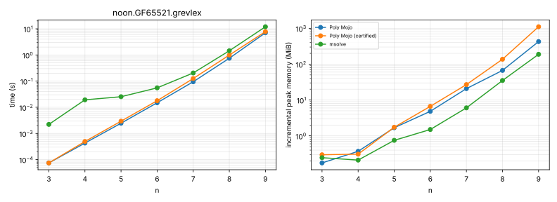
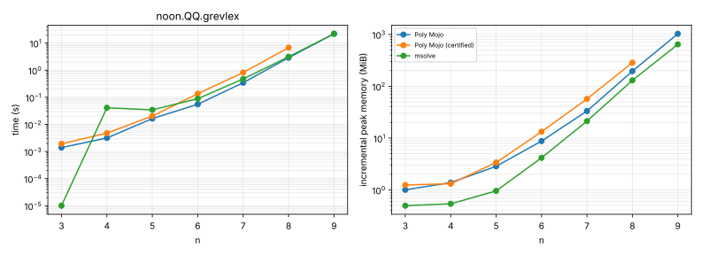
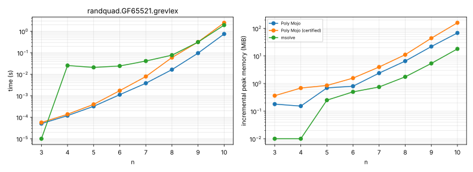
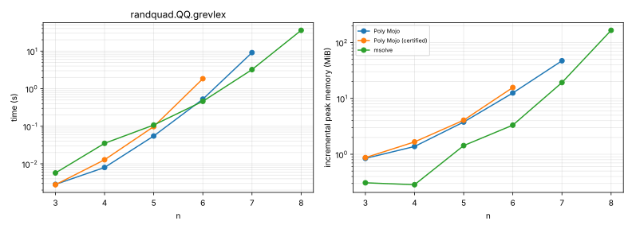
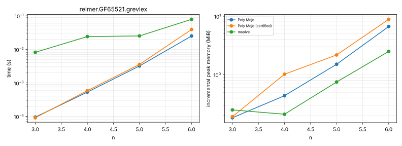
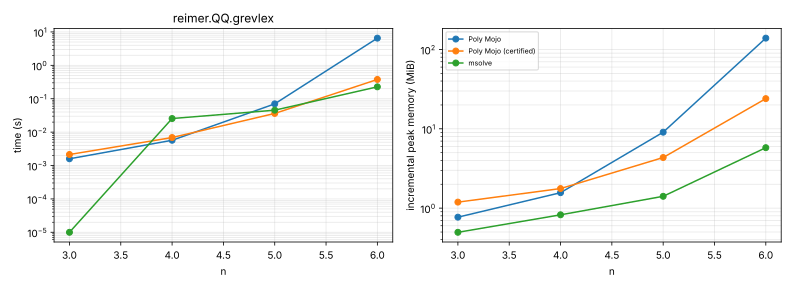
