# Gröbner basis pilot results

> **Run on nightly d1f992f, 2026-10-21, with cuts against the 2026-10-18 settings** (time budget). Memory cap 9G throughout.
> - Time limit: 900 s for the first cyclic GF(65521) grevlex cases; 120 s for cyclic (QQ and GF(65521), grevlex and lex) and eco GF(65521); 60 s for eco QQ, katsura, noon, reimer and randquad. The header line's "900 s" reflects only the first records.
> - SymPy (all four variants) ran only on the first cyclic GF(65521) grevlex cases, then was dropped as the long pole.
> - Singular modStd was dropped after the cyclic and eco GF ladders: it was never the fastest Singular variant there (std 17 cases, stdfglm 4, slimgb 1).
> - Lex ran for cyclic (QQ and GF(65521)), katsura QQ and randquad only.
> - The "Certification overhead" text below still says certified mode retains cofactor rows; since c0913c8/061b451 it records a straight-line trace (GroebnerTrace) and check_groebner replays it.

Host: Intel(R) Xeon(R) Processor @ 2.10GHz, 4 vCPUs (KVM), 16 GiB RAM, Ubuntu 24.04.5 LTS, Linux 6.18.44-fc-v139. Every run is pinned to one CPU and single-threaded, capped at 9G of memory and 900 s.

Versions: Poly Mojo d1f992ffe139; Poly Mojo (certified) d1f992ffe139; Poly Mojo (uncertified) d1f992ffe139; SymPy Buchberger 1.14.0 (gmpy ground types); SymPy F5B 1.14.0 (gmpy ground types); SymPy Buchberger (flint types) 1.14.0 (flint ground types); SymPy FGLM 1.14.0 (gmpy ground types); Singular std 4.4.1; Singular slimgb 4.4.1; Singular modStd 4.4.1; Singular stdfglm 4.4.1; msolve 0.11.0.

Records: 848 (551 ok, 86 skipped, 72 timeout, 139 unsupported).

## Summary

Ratios cover cases that both tools solved with a confirmed answer and on which the slower of the two took at least 10 ms (memory: at least 1 MiB). Poly Mojo runs in comparable mode (no witnesses).

**Time** (geometric mean of competitor ÷ Poly Mojo; above 1 means Poly Mojo used less; *n* = cases compared)

| Field, order | SymPy Buchberger | SymPy F5B | SymPy Buchberger (flint types) | SymPy FGLM | Singular std | Singular slimgb | Singular modStd | Singular stdfglm | msolve |
|---|---|---|---|---|---|---|---|---|---|
| GF(65521), grevlex | 3.55e+03 (*n* = 2) | 4.37e+03 (*n* = 1) | 3.47e+03 (*n* = 2) | — | 28.8 (*n* = 21) | 41.6 (*n* = 19) | — | — | 4.47 (*n* = 29) |
| GF(65521), lex | — | — | — | — | 27.3 (*n* = 2) | 113 (*n* = 2) | — | 14.8 (*n* = 4) | — |
| QQ, grevlex | — | — | — | — | 4 (*n* = 14) | 5.11 (*n* = 16) | 38.2 (*n* = 3) | — | 0.775 (*n* = 24) |
| QQ, lex | — | — | — | — | 5.14 (*n* = 5) | 17.4 (*n* = 3) | 32.5 (*n* = 3) | 2.59 (*n* = 5) | — |

**Incremental peak memory** (geometric mean of competitor ÷ Poly Mojo; above 1 means Poly Mojo used less; *n* = cases compared)

| Field, order | SymPy Buchberger | SymPy F5B | SymPy Buchberger (flint types) | SymPy FGLM | Singular std | Singular slimgb | Singular modStd | Singular stdfglm | msolve |
|---|---|---|---|---|---|---|---|---|---|
| GF(65521), grevlex | 1.5 (*n* = 1) | 2.92 (*n* = 1) | 1.09 (*n* = 1) | — | 0.482 (*n* = 22) | 0.918 (*n* = 22) | — | — | 0.348 (*n* = 27) |
| GF(65521), lex | — | — | — | — | 0.866 (*n* = 2) | 1.23 (*n* = 3) | — | 1.03 (*n* = 5) | — |
| QQ, grevlex | — | — | — | — | 0.454 (*n* = 23) | 0.824 (*n* = 26) | 2.51 (*n* = 3) | — | 0.346 (*n* = 27) |
| QQ, lex | — | — | — | — | 1.03 (*n* = 11) | 1.43 (*n* = 7) | 0.818 (*n* = 3) | 0.86 (*n* = 10) | — |

**Solved cases** (finished within the limits with an answer no other library contradicts):

| Field, order | Poly Mojo | Poly Mojo (certified) | Poly Mojo (uncertified) | SymPy Buchberger | SymPy F5B | SymPy Buchberger (flint types) | SymPy FGLM | Singular std | Singular slimgb | Singular modStd | Singular stdfglm | msolve |
|---|---|---|---|---|---|---|---|---|---|---|---|---|
| GF(65521), grevlex | 43/44 | 34/44 | 43/44 | 3/44 | 2/44 | 3/44 | n/a | 37/44 | 35/44 | n/a | n/a | 42/44 |
| GF(65521), lex | 10/10 | 5/10 | 10/10 | n/a | n/a | n/a | n/a | 7/10 | 8/10 | n/a | 9/10 | n/a |
| QQ, grevlex | 35/44 | 25/44 | 40/44 | n/a | n/a | n/a | n/a | 28/44 | 29/44 | 3/44 | n/a | 38/44 |
| QQ, lex | 12/17 | 5/17 | 13/17 | n/a | n/a | n/a | n/a | 11/17 | 8/17 | 3/17 | 10/17 | n/a |

## Answer agreement

Every answer that two or more libraries computed agrees.

Answers computed by only one library (marked ? in the tables): cyclic-7.QQ.lex, cyclic-9.GF65521.grevlex, eco-13.QQ.grevlex, katsura-11.QQ.grevlex, katsura-7.QQ.lex.

## Certification overhead

Comparable mode computes without witnesses. Certified mode retains cofactor rows and runs `sparse.check_groebner`, which verifies both ideal containments and the Buchberger criterion.

| Case | Comparable | Certified compute | Check | Certified peak ÷ comparable peak |
|---|---|---|---|---|
| cyclic-7.GF65521.grevlex | 44.5 ms | 358 ms | 2.52 s | 2.29 |
| cyclic-8.GF65521.grevlex | 771 ms | 8.8 s | 26.6 s | 3.97 |
| cyclic-5.GF65521.lex | < 1 ms | 734 ms | 57.3 ms | — |
| cyclic-6.QQ.grevlex | 19.8 ms | 132 ms | 121 ms | 1.72 |
| cyclic-5.QQ.lex | 5.95 ms | 4.87 s | 3.5 s | 11.4 |
| eco-9.GF65521.grevlex | 10 ms | 39.2 ms | 1.29 s | 2.24 |
| eco-10.GF65521.grevlex | 39.3 ms | 310 ms | 13.1 s | 2.49 |
| eco-7.QQ.grevlex | 6.84 ms | 15 ms | 47.6 ms | 1.29 |
| eco-8.QQ.grevlex | 37.4 ms | 81.4 ms | 1.01 s | 1.34 |
| eco-9.QQ.grevlex | 111 ms | 523 ms | 5.63 s | 2.05 |
| katsura-7.GF65521.grevlex | 6.5 ms | 34 ms | 436 ms | 1.66 |
| katsura-8.GF65521.grevlex | 23 ms | 211 ms | 5.54 s | 2.05 |
| katsura-9.GF65521.grevlex | 123 ms | 1.75 s | 54.2 s | 2.51 |
| katsura-5.QQ.grevlex | 3.96 ms | 11.4 ms | 51.2 ms | 1.35 |
| katsura-6.QQ.grevlex | 17.2 ms | 91.1 ms | 512 ms | 1.47 |
| katsura-7.QQ.grevlex | 93.5 ms | 1.21 s | 5.42 s | 1.45 |
| noon-6.GF65521.grevlex | 16.4 ms | 19.5 ms | 1.02 s | 1.29 |
| noon-7.GF65521.grevlex | 91.9 ms | 231 ms | 26.2 s | 1.29 |
| noon-5.QQ.grevlex | 11.1 ms | 24.2 ms | 180 ms | 1.17 |
| noon-6.QQ.grevlex | 58.4 ms | 170 ms | 4.1 s | 1.33 |
| randquad-7.GF65521.grevlex | 3.79 ms | 21.3 ms | 218 ms | 1.56 |
| randquad-8.GF65521.grevlex | 17.6 ms | 191 ms | 2.28 s | 1.67 |
| randquad-9.GF65521.grevlex | 100 ms | 1.47 s | 20.8 s | 1.92 |
| randquad-4.QQ.grevlex | 8.57 ms | 44.4 ms | 20.4 ms | 1.3 |
| randquad-5.QQ.grevlex | 54.7 ms | 579 ms | 309 ms | 1.2 |
| randquad-6.QQ.grevlex | 562 ms | 11.3 s | 8.43 s | 1.62 |
| reimer-6.GF65521.grevlex | 31.9 ms | 118 ms | 2.44 s | 1.36 |
| reimer-4.QQ.grevlex | 8.45 ms | 14.3 ms | 22.2 ms | 1.16 |
| reimer-5.QQ.grevlex | 88.2 ms | 126 ms | 275 ms | 1.02 |
| reimer-6.QQ.grevlex | 7.3 s | 7.91 s | 27.1 s | 0.999 |
| randquad-4.GF65521.lex | < 1 ms | 379 ms | 17.9 ms | — |
| randquad-3.QQ.lex | 4.98 ms | 42.3 ms | 32.4 ms | 0.205 |

## Per-ladder results

Each cell gives the median time per call and the incremental peak memory. `·` marks an instance skipped after a smaller one on the same ladder hit a limit; `n/a` marks an unsupported order or field.

#### cyclic-n over GF(65521), grevlex

| n | vars | Poly Mojo | Poly Mojo (certified) | Poly Mojo (uncertified) | SymPy Buchberger | SymPy F5B | SymPy Buchberger (flint types) | SymPy FGLM | Singular std | Singular slimgb | Singular modStd | Singular stdfglm | msolve |
|---|---|---|---|---|---|---|---|---|---|---|---|---|---|
| 4 | 4 | < 1 ms < 1 MiB | < 1 ms < 1 MiB | < 1 ms < 1 MiB | 2.63 ms < 1 MiB | 6.37 ms < 1 MiB | 2.35 ms < 1 MiB | n/a | < 1 ms < 1 MiB | < 1 ms < 1 MiB | n/a | n/a | < 1 ms < 1 MiB |
| 5 | 5 | < 1 ms < 1 MiB | < 1 ms < 1 MiB | < 1 ms < 1 MiB | 337 ms < 1 MiB | 1.57 s 1.18 MiB | 316 ms < 1 MiB | n/a | < 1 ms < 1 MiB | 1.46 ms < 1 MiB | n/a | n/a | < 1 ms < 1 MiB |
| 6 | 6 | 1.72 ms 1.36 MiB | 3.79 ms 2.21 MiB | 1.74 ms 1 MiB | 23.1 s 2.04 MiB | timeout | 23.5 s 1.48 MiB | n/a | 13.1 ms < 1 MiB | 21 ms 1.2 MiB | n/a | n/a | 17.7 ms < 1 MiB |
| 7 | 7 | 44.5 ms 11.5 MiB | 358 ms 26.3 MiB | 47.8 ms 11.4 MiB | timeout | · |  |  | 1.7 s 6.06 MiB | 4.15 s 9.07 MiB | n/a | n/a | 150 ms 3.28 MiB |
| 8 | 8 | 771 ms 54.3 MiB | 8.8 s 216 MiB | 766 ms 53.8 MiB |  |  |  |  | 51.2 s 43.2 MiB | timeout | n/a | n/a | 1.99 s 25.2 MiB |
| 9 | 9 | 81.5 s 1.6 GiB ? | timeout | 81.6 s 1.6 GiB ? |  |  |  |  | timeout | · | n/a | n/a | timeout |

#### eco-n over GF(65521), grevlex

| n | vars | Poly Mojo | Poly Mojo (certified) | Poly Mojo (uncertified) | SymPy Buchberger | SymPy F5B | SymPy Buchberger (flint types) | SymPy FGLM | Singular std | Singular slimgb | Singular modStd | Singular stdfglm | msolve |
|---|---|---|---|---|---|---|---|---|---|---|---|---|---|
| 5 | 5 | < 1 ms < 1 MiB | < 1 ms < 1 MiB | < 1 ms < 1 MiB |  |  |  |  | < 1 ms < 1 MiB | < 1 ms < 1 MiB | n/a | n/a | < 1 ms < 1 MiB |
| 6 | 6 | < 1 ms < 1 MiB | < 1 ms < 1 MiB | < 1 ms < 1 MiB |  |  |  |  | < 1 ms < 1 MiB | 1.07 ms < 1 MiB | n/a | n/a | < 1 ms < 1 MiB |
| 7 | 7 | < 1 ms < 1 MiB | 1.27 ms 1.11 MiB | < 1 ms < 1 MiB |  |  |  |  | 4.15 ms < 1 MiB | 6.81 ms 1.02 MiB | n/a | n/a | 19.8 ms < 1 MiB |
| 8 | 8 | 2.85 ms 1.82 MiB | 6.19 ms 2.45 MiB | 3.16 ms 1.73 MiB |  |  |  |  | 41.2 ms 1.04 MiB | 49.9 ms 1.43 MiB | n/a | n/a | 10.6 ms < 1 MiB |
| 9 | 9 | 10 ms 4.59 MiB | 39.2 ms 10.3 MiB | 9.99 ms 4.84 MiB |  |  |  |  | 327 ms 1.86 MiB | 669 ms 2.68 MiB | n/a | n/a | 46 ms 1.21 MiB |
| 10 | 10 | 39.3 ms 11.2 MiB | 310 ms 28 MiB | 43.4 ms 11.4 MiB |  |  |  |  | 3.79 s 6.43 MiB | 4.89 s 6.32 MiB | n/a | n/a | 136 ms 2.9 MiB |
| 11 | 11 | 212 ms 30.5 MiB | timeout | 216 ms 30.3 MiB |  |  |  |  | 41.8 s 14.9 MiB | 100 s 16.8 MiB | n/a | n/a | 738 ms 10.7 MiB |
| 12 | 12 | 1.55 s 86.4 MiB | · | 1.64 s 84.1 MiB |  |  |  |  | timeout | timeout | n/a | n/a | 5.5 s 36.6 MiB |
| 13 | 13 | 10.1 s 282 MiB | · | 10.2 s 284 MiB |  |  |  |  | · | · | n/a | n/a | 38.2 s 162 MiB |

#### katsura-n over GF(65521), grevlex

| n | vars | Poly Mojo | Poly Mojo (certified) | Poly Mojo (uncertified) | SymPy Buchberger | SymPy F5B | SymPy Buchberger (flint types) | SymPy FGLM | Singular std | Singular slimgb | Singular modStd | Singular stdfglm | msolve |
|---|---|---|---|---|---|---|---|---|---|---|---|---|---|
| 3 | 4 | < 1 ms < 1 MiB | < 1 ms < 1 MiB | < 1 ms < 1 MiB |  |  |  |  | < 1 ms < 1 MiB | < 1 ms < 1 MiB |  | n/a | < 1 ms < 1 MiB |
| 4 | 5 | < 1 ms < 1 MiB | < 1 ms < 1 MiB | < 1 ms < 1 MiB |  |  |  |  | < 1 ms < 1 MiB | < 1 ms < 1 MiB |  | n/a | < 1 ms < 1 MiB |
| 5 | 6 | < 1 ms < 1 MiB | 1.1 ms < 1 MiB | < 1 ms < 1 MiB |  |  |  |  | 2.55 ms < 1 MiB | 3.43 ms 1.11 MiB |  | n/a | < 1 ms < 1 MiB |
| 6 | 7 | 1.31 ms 1.29 MiB | 4.86 ms 1.96 MiB | 1.42 ms < 1 MiB |  |  |  |  | 19.1 ms < 1 MiB | 20.2 ms 1.48 MiB |  | n/a | 10.6 ms < 1 MiB |
| 7 | 8 | 6.5 ms 2.82 MiB | 34 ms 4.7 MiB | 4.92 ms 2.84 MiB |  |  |  |  | 152 ms 1.16 MiB | 187 ms 4.8 MiB |  | n/a | 24.6 ms 1.02 MiB |
| 8 | 9 | 23 ms 8.75 MiB | 211 ms 17.9 MiB | 32.9 ms 8.68 MiB |  |  |  |  | 1.28 s 2.27 MiB | 2.79 s 10.6 MiB |  | n/a | 58.7 ms 2 MiB |
| 9 | 10 | 123 ms 24.9 MiB | 1.75 s 62.5 MiB | 144 ms 24.8 MiB |  |  |  |  | 12.1 s 6.8 MiB | 29 s 24.4 MiB |  | n/a | 411 ms 5.92 MiB |
| 10 | 11 | 1.1 s 78.9 MiB | timeout | 1.17 s 80.9 MiB |  |  |  |  | timeout | timeout |  | n/a | 3.02 s 22.2 MiB |
| 11 | 12 | 7.94 s 254 MiB | · | 7.46 s 253 MiB |  |  |  |  | · | · |  | n/a | 23 s 91.3 MiB |
| 12 | 13 | timeout | · | timeout |  |  |  |  | · | · |  | n/a | timeout |

#### noon-n over GF(65521), grevlex

| n | vars | Poly Mojo | Poly Mojo (certified) | Poly Mojo (uncertified) | SymPy Buchberger | SymPy F5B | SymPy Buchberger (flint types) | SymPy FGLM | Singular std | Singular slimgb | Singular modStd | Singular stdfglm | msolve |
|---|---|---|---|---|---|---|---|---|---|---|---|---|---|
| 3 | 3 | < 1 ms < 1 MiB | < 1 ms < 1 MiB | < 1 ms < 1 MiB |  |  |  |  | < 1 ms < 1 MiB | < 1 ms < 1 MiB |  | n/a | < 1 ms < 1 MiB |
| 4 | 4 | < 1 ms < 1 MiB | < 1 ms < 1 MiB | < 1 ms < 1 MiB |  |  |  |  | < 1 ms < 1 MiB | < 1 ms < 1 MiB |  | n/a | < 1 ms < 1 MiB |
| 5 | 5 | 3.58 ms 1.82 MiB | 4.7 ms 1.84 MiB | 3.37 ms 1.82 MiB |  |  |  |  | 5.99 ms < 1 MiB | 7.43 ms 1.27 MiB |  | n/a | 25.6 ms < 1 MiB |
| 6 | 6 | 16.4 ms 5.13 MiB | 19.5 ms 6.61 MiB | 14.6 ms 5.12 MiB |  |  |  |  | 54.5 ms 1.49 MiB | 91.6 ms 2.85 MiB |  | n/a | 61.6 ms 1.5 MiB |
| 7 | 7 | 91.9 ms 21.1 MiB | 231 ms 27.2 MiB | 108 ms 21.2 MiB |  |  |  |  | 505 ms 4.93 MiB | 1.25 s 10.4 MiB |  | n/a | 217 ms 6.04 MiB |
| 8 | 8 | 806 ms 66.5 MiB | timeout | 902 ms 66.6 MiB |  |  |  |  | 4.3 s 21.2 MiB | 22.5 s 44.4 MiB |  | n/a | 1.47 s 35 MiB |
| 9 | 9 | 6.85 s 432 MiB | · | 6.75 s 431 MiB |  |  |  |  | 47.5 s 134 MiB | timeout |  | n/a | 11.9 s 188 MiB |

#### randquad-n over GF(65521), grevlex

| n | vars | Poly Mojo | Poly Mojo (certified) | Poly Mojo (uncertified) | SymPy Buchberger | SymPy F5B | SymPy Buchberger (flint types) | SymPy FGLM | Singular std | Singular slimgb | Singular modStd | Singular stdfglm | msolve |
|---|---|---|---|---|---|---|---|---|---|---|---|---|---|
| 3 | 3 | < 1 ms < 1 MiB | < 1 ms < 1 MiB | < 1 ms < 1 MiB |  |  |  |  | < 1 ms < 1 MiB | < 1 ms < 1 MiB |  | n/a | 7.34 ms < 1 MiB |
| 4 | 4 | < 1 ms < 1 MiB | < 1 ms < 1 MiB | < 1 ms < 1 MiB |  |  |  |  | < 1 ms < 1 MiB | < 1 ms < 1 MiB |  | n/a | < 1 ms < 1 MiB |
| 5 | 5 | < 1 ms < 1 MiB | < 1 ms < 1 MiB | < 1 ms < 1 MiB |  |  |  |  | 2.93 ms < 1 MiB | 2.75 ms < 1 MiB |  | n/a | 15.4 ms < 1 MiB |
| 6 | 6 | 1.15 ms 1.25 MiB | 4.72 ms 1.81 MiB | 1.65 ms < 1 MiB |  |  |  |  | 16.3 ms < 1 MiB | 20.6 ms 1.45 MiB |  | n/a | 20.4 ms < 1 MiB |
| 7 | 7 | 3.79 ms 2.54 MiB | 21.3 ms 3.97 MiB | 3.95 ms 2.53 MiB |  |  |  |  | 119 ms 1.16 MiB | 147 ms 3.48 MiB |  | n/a | 25.5 ms < 1 MiB |
| 8 | 8 | 17.6 ms 6.82 MiB | 191 ms 11.4 MiB | 25.4 ms 6.58 MiB |  |  |  |  | 1.04 s 2.09 MiB | 1.6 s 8.36 MiB |  | n/a | 76 ms 1.75 MiB |
| 9 | 9 | 100 ms 23 MiB | 1.47 s 44.1 MiB | 96.1 ms 22.7 MiB |  |  |  |  | 7.46 s 6.76 MiB | 14.3 s 21.4 MiB |  | n/a | 287 ms 5.33 MiB |
| 10 | 10 | 703 ms 63.7 MiB | timeout | 737 ms 68 MiB |  |  |  |  | timeout | timeout |  | n/a | 1.88 s 18.1 MiB |

#### reimer-n over GF(65521), grevlex

| n | vars | Poly Mojo | Poly Mojo (certified) | Poly Mojo (uncertified) | SymPy Buchberger | SymPy F5B | SymPy Buchberger (flint types) | SymPy FGLM | Singular std | Singular slimgb | Singular modStd | Singular stdfglm | msolve |
|---|---|---|---|---|---|---|---|---|---|---|---|---|---|
| 3 | 3 | < 1 ms < 1 MiB | < 1 ms < 1 MiB | < 1 ms < 1 MiB |  |  |  |  | < 1 ms < 1 MiB | < 1 ms < 1 MiB |  | n/a | < 1 ms < 1 MiB |
| 4 | 4 | < 1 ms < 1 MiB | < 1 ms < 1 MiB | < 1 ms < 1 MiB |  |  |  |  | 1.67 ms < 1 MiB | 1.78 ms < 1 MiB |  | n/a | < 1 ms < 1 MiB |
| 5 | 5 | 3.3 ms 1.72 MiB | 8.06 ms 2.19 MiB | 5.4 ms 1.77 MiB |  |  |  |  | 80.6 ms 1.44 MiB | 33.4 ms 1.6 MiB |  | n/a | 32.7 ms < 1 MiB |
| 6 | 6 | 31.9 ms 6.41 MiB | 118 ms 8.71 MiB | 25.1 ms 6.62 MiB |  |  |  |  | 13.6 s 20.1 MiB | 934 ms 8.85 MiB |  | n/a | 91.6 ms 2.5 MiB |

#### cyclic-n over QQ, grevlex

| n | vars | Poly Mojo | Poly Mojo (certified) | Poly Mojo (uncertified) | SymPy Buchberger | SymPy F5B | SymPy Buchberger (flint types) | SymPy FGLM | Singular std | Singular slimgb | Singular modStd | Singular stdfglm | msolve |
|---|---|---|---|---|---|---|---|---|---|---|---|---|---|
| 4 | 4 | 1.2 ms < 1 MiB | 1.45 ms < 1 MiB | < 1 ms < 1 MiB |  |  |  |  | < 1 ms < 1 MiB | < 1 ms < 1 MiB | 104 ms 2.09 MiB | n/a | < 1 ms < 1 MiB |
| 5 | 5 | 3.56 ms 1.41 MiB | 7.32 ms 1.66 MiB | < 1 ms < 1 MiB |  |  |  |  | 1.02 ms < 1 MiB | 1.55 ms 1.02 MiB | 117 ms 2.63 MiB | n/a | < 1 ms < 1 MiB |
| 6 | 6 | 19.8 ms 2.76 MiB | 132 ms 4.73 MiB | 4.07 ms 1.65 MiB |  |  |  |  | 54 ms 1.38 MiB | 63.3 ms 1.68 MiB | 388 ms 5.51 MiB | n/a | 11.7 ms 1.49 MiB |
| 7 | 7 | 1.67 s 53.6 MiB | timeout | 234 ms 28.5 MiB |  |  |  |  | timeout | timeout | timeout | n/a | 858 ms 9.75 MiB |
| 8 | 8 | timeout | · | 6.53 s 167 MiB |  |  |  |  | · | · | · | n/a | 20.1 s 63.7 MiB |
| 9 | 9 | · | · | timeout |  |  |  |  | · | · | · | n/a | timeout |

#### eco-n over QQ, grevlex

| n | vars | Poly Mojo | Poly Mojo (certified) | Poly Mojo (uncertified) | SymPy Buchberger | SymPy F5B | SymPy Buchberger (flint types) | SymPy FGLM | Singular std | Singular slimgb | Singular modStd | Singular stdfglm | msolve |
|---|---|---|---|---|---|---|---|---|---|---|---|---|---|
| 5 | 5 | 1.62 ms < 1 MiB | 2.47 ms < 1 MiB | < 1 ms < 1 MiB |  |  |  |  | < 1 ms < 1 MiB | < 1 ms 1.01 MiB |  | n/a | 3.16 ms < 1 MiB |
| 6 | 6 | 3.34 ms < 1 MiB | 5.56 ms 1.47 MiB | < 1 ms < 1 MiB |  |  |  |  | < 1 ms 1.07 MiB | 1.68 ms 1.07 MiB |  | n/a | < 1 ms < 1 MiB |
| 7 | 7 | 6.84 ms 1.61 MiB | 15 ms 2.08 MiB | 1.77 ms < 1 MiB |  |  |  |  | 4.64 ms 1.12 MiB | 7.94 ms 1.29 MiB |  | n/a | < 1 ms < 1 MiB |
| 8 | 8 | 37.4 ms 4.61 MiB | 81.4 ms 6.17 MiB | 6.6 ms 2.83 MiB |  |  |  |  | 77.4 ms 1.39 MiB | 96.4 ms 1.97 MiB |  | n/a | 28.2 ms 1.91 MiB |
| 9 | 9 | 111 ms 12.3 MiB | 523 ms 25.2 MiB | 21.9 ms 6.83 MiB |  |  |  |  | 1.04 s 2.72 MiB | 1.57 s 3.87 MiB |  | n/a | 115 ms 3.32 MiB |
| 10 | 10 | 620 ms 35.1 MiB | timeout | 92.1 ms 20.8 MiB |  |  |  |  | 24.7 s 16.9 MiB | 18.1 s 9.24 MiB |  | n/a | 446 ms 8.98 MiB |
| 11 | 11 | 6.58 s 125 MiB | · | 634 ms 77 MiB |  |  |  |  | timeout | timeout |  | n/a | 3.12 s 38.4 MiB |
| 12 | 12 | 39.1 s 448 MiB | · | 3.85 s 229 MiB |  |  |  |  | · | · |  | n/a | 18.9 s 155 MiB |
| 13 | 13 | timeout | · | 28.1 s 1.01e+03 MiB ? |  |  |  |  | · | · |  | n/a | timeout |

#### katsura-n over QQ, grevlex

| n | vars | Poly Mojo | Poly Mojo (certified) | Poly Mojo (uncertified) | SymPy Buchberger | SymPy F5B | SymPy Buchberger (flint types) | SymPy FGLM | Singular std | Singular slimgb | Singular modStd | Singular stdfglm | msolve |
|---|---|---|---|---|---|---|---|---|---|---|---|---|---|
| 3 | 4 | 1.38 ms < 1 MiB | 2.32 ms 1.01 MiB | < 1 ms < 1 MiB |  |  |  |  | < 1 ms < 1 MiB | < 1 ms 1.09 MiB |  | n/a | < 1 ms < 1 MiB |
| 4 | 5 | 2.03 ms < 1 MiB | 3.62 ms < 1 MiB | < 1 ms < 1 MiB |  |  |  |  | < 1 ms 1.06 MiB | 1.07 ms 1.16 MiB |  | n/a | 7.16 ms < 1 MiB |
| 5 | 6 | 3.96 ms 1.2 MiB | 11.4 ms 1.62 MiB | 1.65 ms < 1 MiB |  |  |  |  | 9.35 ms 1.11 MiB | 10 ms 1.45 MiB |  | n/a | 10.6 ms < 1 MiB |
| 6 | 7 | 17.2 ms 2.27 MiB | 91.1 ms 3.33 MiB | 5.59 ms 1.97 MiB |  |  |  |  | 75.2 ms 1.26 MiB | 96.7 ms 2.54 MiB |  | n/a | 29.1 ms < 1 MiB |
| 7 | 8 | 93.5 ms 7.54 MiB | 1.21 s 10.9 MiB | 28 ms 5.78 MiB |  |  |  |  | 713 ms 1.82 MiB | 1.12 s 10.7 MiB |  | n/a | 62.9 ms 2.89 MiB |
| 8 | 9 | 611 ms 25.6 MiB | timeout | 124 ms 22.2 MiB |  |  |  |  | 6.2 s 5.17 MiB | 13.8 s 34.6 MiB |  | n/a | 355 ms 6.91 MiB |
| 9 | 10 | 5.75 s 87.4 MiB | · | 905 ms 76.4 MiB |  |  |  |  | timeout | timeout |  | n/a | 2.44 s 31.6 MiB |
| 10 | 11 | timeout | · | 6.74 s 291 MiB |  |  |  |  | · | · |  | n/a | 15.8 s 154 MiB |
| 11 | 12 | · | · | 49.9 s 1.34 GiB ? |  |  |  |  | · | · |  | n/a | timeout |
| 12 | 13 | · | · | timeout |  |  |  |  | · | · |  | n/a | · |

#### noon-n over QQ, grevlex

| n | vars | Poly Mojo | Poly Mojo (certified) | Poly Mojo (uncertified) | SymPy Buchberger | SymPy F5B | SymPy Buchberger (flint types) | SymPy FGLM | Singular std | Singular slimgb | Singular modStd | Singular stdfglm | msolve |
|---|---|---|---|---|---|---|---|---|---|---|---|---|---|
| 3 | 3 | 1.36 ms < 1 MiB | 1.88 ms < 1 MiB | < 1 ms < 1 MiB |  |  |  |  | < 1 ms < 1 MiB | < 1 ms < 1 MiB |  | n/a | < 1 ms < 1 MiB |
| 4 | 4 | 3.2 ms 1.3 MiB | 5.33 ms 1.61 MiB | 1.11 ms < 1 MiB |  |  |  |  | < 1 ms < 1 MiB | < 1 ms < 1 MiB |  | n/a | < 1 ms < 1 MiB |
| 5 | 5 | 11.1 ms 2.96 MiB | 24.2 ms 3.46 MiB | 4.88 ms 2.1 MiB |  |  |  |  | 6.36 ms 1.09 MiB | 8.16 ms 1.21 MiB |  | n/a | 23.7 ms < 1 MiB |
| 6 | 6 | 58.4 ms 8.36 MiB | 170 ms 11.1 MiB | 29.2 ms 6.77 MiB |  |  |  |  | 77.2 ms 1.89 MiB | 120 ms 3.12 MiB |  | n/a | 82.3 ms 4.15 MiB |
| 7 | 7 | 392 ms 33.5 MiB | timeout | 177 ms 30.4 MiB |  |  |  |  | 834 ms 5.21 MiB | 2.35 s 17.7 MiB |  | n/a | 453 ms 21.2 MiB |
| 8 | 8 | 2.99 s 194 MiB | · | 1.31 s 153 MiB |  |  |  |  | 9.04 s 25.5 MiB | 51.5 s 90.6 MiB |  | n/a | 3.35 s 122 MiB |
| 9 | 9 | 23.7 s 1.01 GiB | · | 10.5 s 820 MiB |  |  |  |  | timeout | timeout |  | n/a | 24.9 s 642 MiB |

#### randquad-n over QQ, grevlex

| n | vars | Poly Mojo | Poly Mojo (certified) | Poly Mojo (uncertified) | SymPy Buchberger | SymPy F5B | SymPy Buchberger (flint types) | SymPy FGLM | Singular std | Singular slimgb | Singular modStd | Singular stdfglm | msolve |
|---|---|---|---|---|---|---|---|---|---|---|---|---|---|
| 3 | 3 | 2.04 ms < 1 MiB | 4.34 ms 1.06 MiB | < 1 ms < 1 MiB |  |  |  |  | < 1 ms 1.07 MiB | < 1 ms 1.23 MiB |  | n/a | 3.73 ms < 1 MiB |
| 4 | 4 | 8.57 ms 1.4 MiB | 44.4 ms 1.82 MiB | 3.07 ms 1.11 MiB |  |  |  |  | 3.02 ms 1.11 MiB | 2.9 ms 1.27 MiB |  | n/a | 16.8 ms < 1 MiB |
| 5 | 5 | 54.7 ms 3.8 MiB | 579 ms 4.56 MiB | 22.3 ms 1.71 MiB |  |  |  |  | 72.5 ms 1.71 MiB | 79.9 ms 4.32 MiB |  | n/a | 78.5 ms 1.43 MiB |
| 6 | 6 | 562 ms 11.7 MiB | 11.3 s 19 MiB | 169 ms 6.33 MiB |  |  |  |  | 9.79 s 3.89 MiB | 50.1 s 212 MiB |  | n/a | 553 ms 3.32 MiB |
| 7 | 7 | 9.58 s 47.3 MiB | timeout | 1.47 s 37.8 MiB |  |  |  |  | timeout | timeout |  | n/a | 4.02 s 19.1 MiB |
| 8 | 8 | timeout | · | 17.1 s 334 MiB |  |  |  |  | · | · |  | n/a | 38.4 s 166 MiB |
| 9 | 9 | · | · | timeout |  |  |  |  | · | · |  | n/a | timeout |
| 10 | 10 | · | · | · |  |  |  |  | · | · |  | n/a | · |

#### reimer-n over QQ, grevlex

| n | vars | Poly Mojo | Poly Mojo (certified) | Poly Mojo (uncertified) | SymPy Buchberger | SymPy F5B | SymPy Buchberger (flint types) | SymPy FGLM | Singular std | Singular slimgb | Singular modStd | Singular stdfglm | msolve |
|---|---|---|---|---|---|---|---|---|---|---|---|---|---|
| 3 | 3 | 2.01 ms < 1 MiB | 2.92 ms < 1 MiB | < 1 ms < 1 MiB |  |  |  |  | < 1 ms < 1 MiB | < 1 ms < 1 MiB |  | n/a | 9.09 ms < 1 MiB |
| 4 | 4 | 8.45 ms 1.69 MiB | 14.3 ms 1.96 MiB | 1.74 ms < 1 MiB |  |  |  |  | 4.58 ms 1.16 MiB | 3.99 ms 1.25 MiB |  | n/a | 10.8 ms < 1 MiB |
| 5 | 5 | 88.2 ms 9.25 MiB | 126 ms 9.41 MiB | 7.75 ms 2.47 MiB |  |  |  |  | 297 ms 2.23 MiB | 132 ms 2.39 MiB |  | n/a | 38.8 ms 1.66 MiB |
| 6 | 6 | 7.3 s 140 MiB | 7.91 s 140 MiB | 74.3 ms 14.3 MiB |  |  |  |  | timeout | 3.93 s 19.4 MiB |  | n/a | 204 ms 5.78 MiB |

#### cyclic-n over GF(65521), lex

| n | vars | Poly Mojo | Poly Mojo (certified) | Poly Mojo (uncertified) | SymPy Buchberger | SymPy F5B | SymPy Buchberger (flint types) | SymPy FGLM | Singular std | Singular slimgb | Singular modStd | Singular stdfglm | msolve |
|---|---|---|---|---|---|---|---|---|---|---|---|---|---|
| 4 | 4 | < 1 ms < 1 MiB | < 1 ms < 1 MiB | < 1 ms < 1 MiB |  |  |  |  | < 1 ms < 1 MiB | < 1 ms < 1 MiB | n/a | n/a | n/a |
| 5 | 5 | < 1 ms < 1 MiB | 734 ms 16.1 MiB | < 1 ms < 1 MiB |  |  |  |  | 1.24 ms < 1 MiB | 3.09 ms < 1 MiB | n/a | 2.39 ms 1 MiB | n/a |
| 6 | 6 | 2.96 ms 1.87 MiB | timeout | 3 ms 1.91 MiB |  |  |  |  | 66.3 ms < 1 MiB | 340 ms 1.87 MiB | n/a | 21.2 ms 1.64 MiB | n/a |
| 7 | 7 | 140 ms 26.8 MiB | · | 145 ms 26.6 MiB |  |  |  |  | timeout | timeout | n/a | 3.09 s 28.1 MiB | n/a |

#### randquad-n over GF(65521), lex

| n | vars | Poly Mojo | Poly Mojo (certified) | Poly Mojo (uncertified) | SymPy Buchberger | SymPy F5B | SymPy Buchberger (flint types) | SymPy FGLM | Singular std | Singular slimgb | Singular modStd | Singular stdfglm | msolve |
|---|---|---|---|---|---|---|---|---|---|---|---|---|---|
| 2 | 2 | < 1 ms < 1 MiB | < 1 ms < 1 MiB | < 1 ms < 1 MiB |  |  |  |  | < 1 ms < 1 MiB | < 1 ms < 1 MiB |  | < 1 ms < 1 MiB | n/a |
| 3 | 3 | < 1 ms < 1 MiB | < 1 ms < 1 MiB | < 1 ms < 1 MiB |  |  |  |  | < 1 ms < 1 MiB | < 1 ms < 1 MiB |  | < 1 ms < 1 MiB | n/a |
| 4 | 4 | < 1 ms < 1 MiB | 379 ms 4.79 MiB | < 1 ms < 1 MiB |  |  |  |  | < 1 ms < 1 MiB | < 1 ms < 1 MiB |  | < 1 ms < 1 MiB | n/a |
| 5 | 5 | < 1 ms < 1 MiB | timeout | < 1 ms < 1 MiB |  |  |  |  | 14.1 ms 1.26 MiB | 8.92 ms 1.02 MiB |  | 4.3 ms < 1 MiB | n/a |
| 6 | 6 | 2.05 ms 1.28 MiB | · | 1.64 ms 1 MiB |  |  |  |  | timeout | 228 ms 1.99 MiB |  | 28.2 ms 1.15 MiB | n/a |
| 7 | 7 | 8.88 ms 2.57 MiB | · | 6.37 ms 2.72 MiB |  |  |  |  | · | timeout |  | 198 ms 2.14 MiB | n/a |

#### cyclic-n over QQ, lex

| n | vars | Poly Mojo | Poly Mojo (certified) | Poly Mojo (uncertified) | SymPy Buchberger | SymPy F5B | SymPy Buchberger (flint types) | SymPy FGLM | Singular std | Singular slimgb | Singular modStd | Singular stdfglm | msolve |
|---|---|---|---|---|---|---|---|---|---|---|---|---|---|
| 4 | 4 | 1.28 ms < 1 MiB | < 1 ms < 1 MiB | < 1 ms < 1 MiB |  |  |  |  | < 1 ms 1.12 MiB | < 1 ms < 1 MiB | 75.8 ms 2.07 MiB | n/a | n/a |
| 5 | 5 | 5.95 ms 3 MiB | 4.87 s 34.4 MiB | 2.15 ms 3.15 MiB |  |  |  |  | 6.48 ms 1.5 MiB | 9.6 ms 1.21 MiB | 128 ms 2.34 MiB | 3.55 ms 1.46 MiB | n/a |
| 6 | 6 | 78.2 ms 13 MiB | timeout | 12.8 ms 13.3 MiB |  |  |  |  | 384 ms 2.37 MiB | timeout | 2.1 s 2.92 MiB | 107 ms 3.07 MiB | n/a |
| 7 | 7 | timeout | · | 3.41 s 322 MiB ? |  |  |  |  | timeout | · | timeout | timeout | n/a |

#### katsura-n over QQ, lex

| n | vars | Poly Mojo | Poly Mojo (certified) | Poly Mojo (uncertified) | SymPy Buchberger | SymPy F5B | SymPy Buchberger (flint types) | SymPy FGLM | Singular std | Singular slimgb | Singular modStd | Singular stdfglm | msolve |
|---|---|---|---|---|---|---|---|---|---|---|---|---|---|
| 3 | 4 | 1.62 ms 1.36 MiB | 2.75 ms < 1 MiB | < 1 ms 1.16 MiB |  |  |  |  | < 1 ms 1.35 MiB | < 1 ms 1.16 MiB |  | < 1 ms 1.24 MiB | n/a |
| 4 | 5 | 4.36 ms 1.24 MiB | timeout | 3.1 ms 1.6 MiB |  |  |  |  | 4 ms 1.47 MiB | 11.9 ms 1.64 MiB |  | 3.96 ms 1.42 MiB | n/a |
| 5 | 6 | 39.1 ms 2.16 MiB | · | 20.6 ms 2.02 MiB |  |  |  |  | 239 ms 2.37 MiB | 55.7 s 42.5 MiB |  | 92 ms 1.86 MiB | n/a |
| 6 | 7 | 588 ms 6.7 MiB | · | 288 ms 6.85 MiB |  |  |  |  | 39.1 s 20.1 MiB | timeout |  | 2.07 s 7.75 MiB | n/a |
| 7 | 8 | 12.6 s 35.2 MiB ? | · | 6.1 s 34.5 MiB ? |  |  |  |  | timeout | · |  | timeout | n/a |
| 8 | 9 | timeout | · | timeout |  |  |  |  | · | · |  | · | n/a |
| 9 | 10 | · | · | · |  |  |  |  | · | · |  | · | n/a |

#### randquad-n over QQ, lex

| n | vars | Poly Mojo | Poly Mojo (certified) | Poly Mojo (uncertified) | SymPy Buchberger | SymPy F5B | SymPy Buchberger (flint types) | SymPy FGLM | Singular std | Singular slimgb | Singular modStd | Singular stdfglm | msolve |
|---|---|---|---|---|---|---|---|---|---|---|---|---|---|
| 2 | 2 | 1.52 ms < 1 MiB | < 1 ms < 1 MiB | < 1 ms 1.28 MiB |  |  |  |  | < 1 ms 1.38 MiB | < 1 ms 1.15 MiB |  | < 1 ms 1.18 MiB | n/a |
| 3 | 3 | 4.98 ms 1.43 MiB | 42.3 ms < 1 MiB | 2.35 ms < 1 MiB |  |  |  |  | < 1 ms 1.41 MiB | < 1 ms 1.24 MiB |  | 1.82 ms 1.22 MiB | n/a |
| 4 | 4 | 42.9 ms 2.18 MiB | timeout | 25 ms 1.86 MiB |  |  |  |  | 17.8 ms 1.76 MiB | 57.9 ms 1.8 MiB |  | 90.6 ms 1.71 MiB | n/a |
| 5 | 5 | 948 ms 5.84 MiB | · | 419 ms 3.9 MiB |  |  |  |  | 4.1 s 7.69 MiB | timeout |  | 4.57 s 8.24 MiB | n/a |
| 6 | 6 | timeout | · | timeout |  |  |  |  | timeout | · |  | timeout | n/a |
| 7 | 7 | · | · | · |  |  |  |  | · | · |  | · | n/a |

## Plots

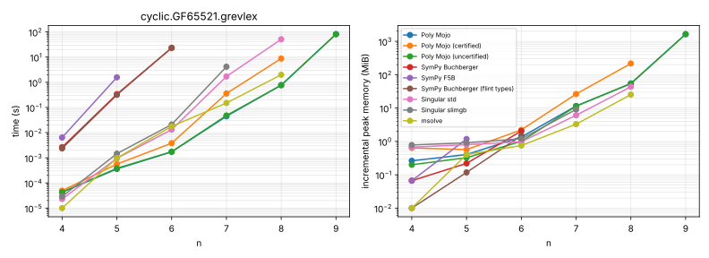
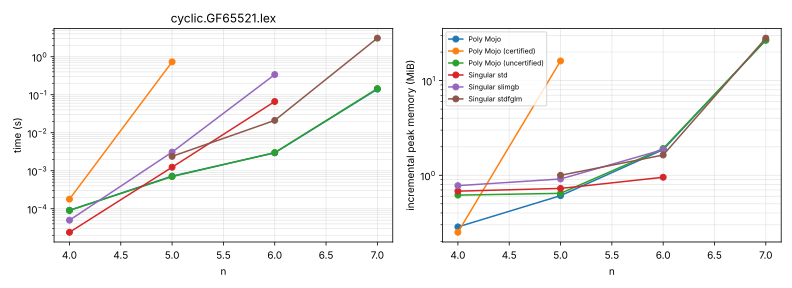
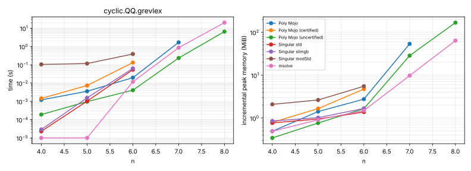
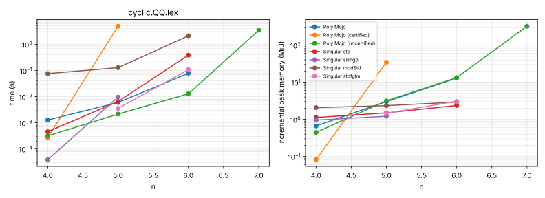
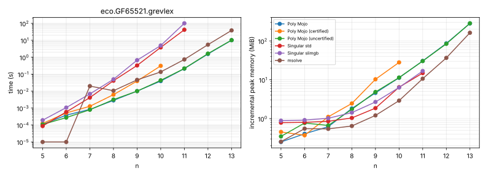
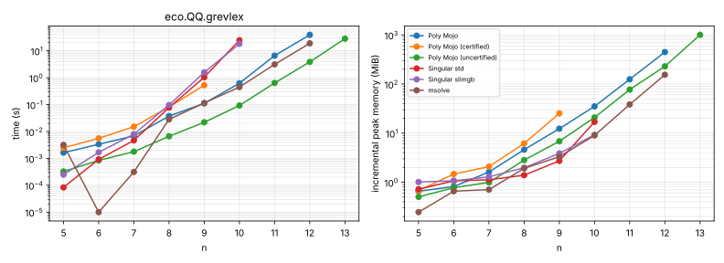
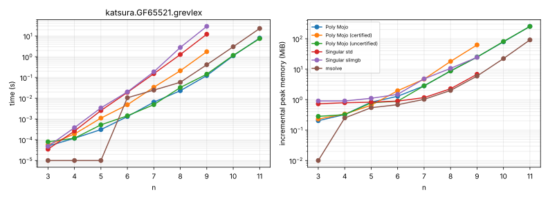
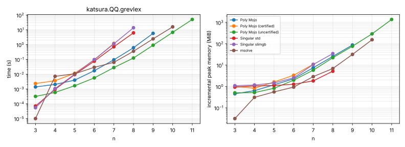
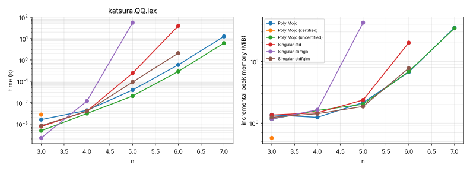
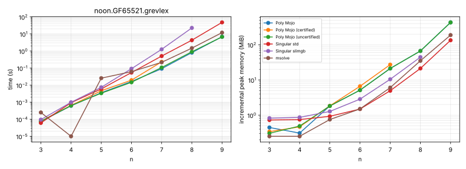
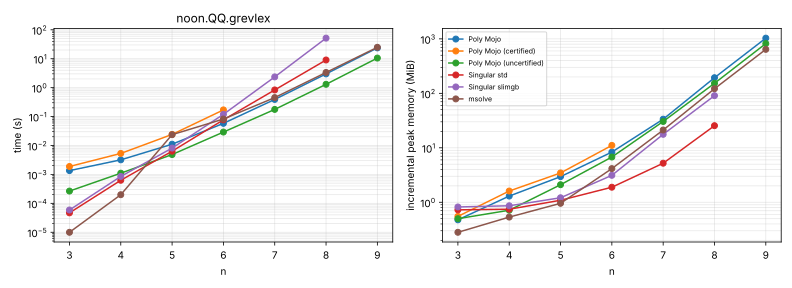
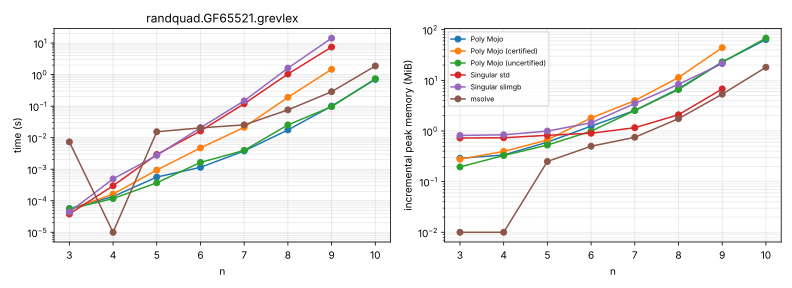
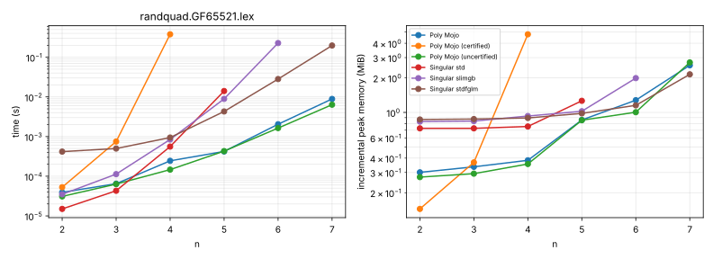
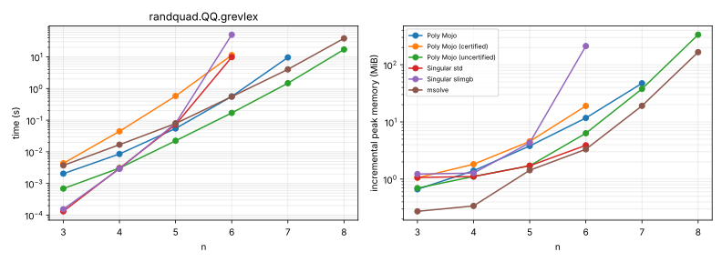
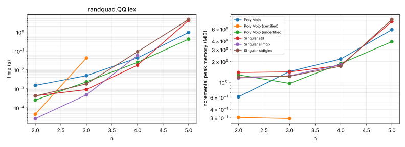
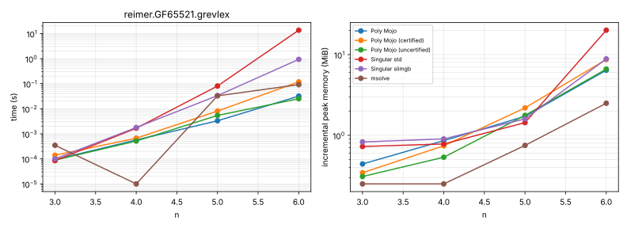
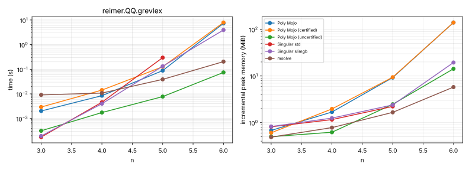
