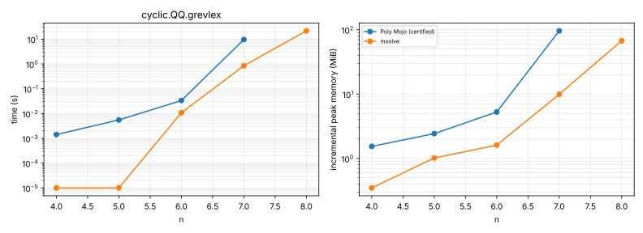
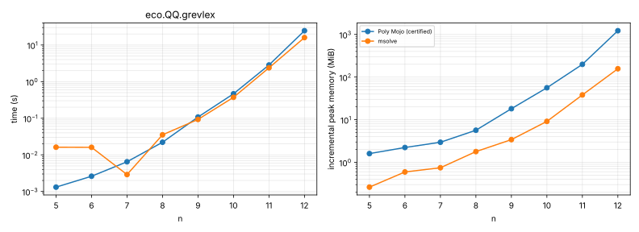
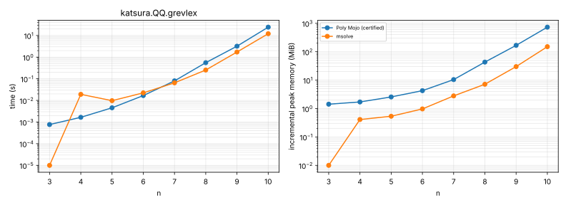
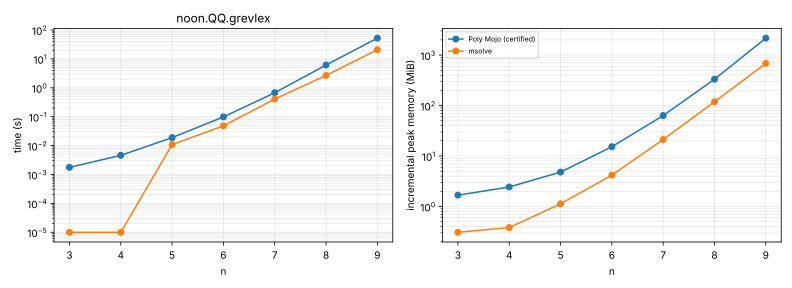
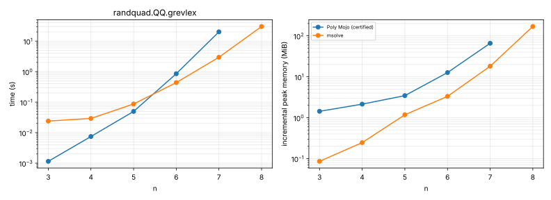
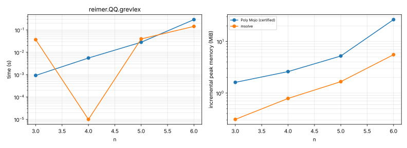

# Gröbner basis pilot results

> **Certified QQ rerun with the compute-only limit, 2026-10-22/23** (wave 7). Poly Mojo (certified) at 7a3d0fc's sources (the étale certificate; recorded under the later commits 085cd68 to be4b2c7, which change only the harness and results; library built by `pixi run build` from that tree), against msolve 0.11.0; grevlex over QQ only; 9G cap.
> - The 60 s limit covers the certified computation, which proves its own result; `check_groebner` then runs under its own 600 s allowance, must pass for the outcome to be ok, and its time is `check_s` in the records (harness change 085cd68). msolve verifies nothing.
> - Seven records read `+dirty` when written, from an uncommitted change in the working tree that the measured binaries did not contain; their labels were corrected to the commit.
> - msolve ÷ certified time, geometric mean, cases where both take at least 10 ms (the assessment's rule): all 0.58 (n = 22); eco 0.90 (5), katsura 0.67 (5), randquad 0.51 (3), reimer 0.84 (2), noon 0.49 (5), cyclic 0.17 (2). noon-8 and noon-9 here predate the reducedness-check fix (with it, 4.3 s and 27.5 s: about 0.61 overall).
>   - Secondary, with the slower of the two at least 10 ms, which takes in cases where msolve's time is mostly its process baseline (eco-5: ours 1.3 ms, msolve 16 ms): all 1.11 (n = 28); eco 1.73 (7), katsura 1.07 (6), randquad 1.61 (5), reimer 3.03 (3), noon 0.49 (5), cyclic 0.17 (2).
> - Solved: certified 36/44, msolve 38/44 (10-22 run, with the check inside the limit: 32/44).
> - noon-9 here predates the reducedness-check fix (52.2 s here, inside the limit; 27.5 s with it).
> - The summary table below compares against Poly Mojo's comparable tier, absent from this run, hence its dashes.

Host: Intel(R) Xeon(R) Processor @ 2.10GHz, 4 vCPUs (KVM), 16 GiB RAM, Ubuntu 24.04.5 LTS, Linux 6.18.44-fc-v140. Every run is pinned to one CPU and single-threaded, capped at 9G of memory and 60 s.

Versions: Poly Mojo (certified) 085cd68a90e9; msolve 0.11.0.

Records: 88 (74 ok, 6 skipped, 8 timeout).

## Summary

Ratios cover cases that both tools solved with a confirmed answer and on which the slower of the two took at least 10 ms (memory: at least 1 MiB). Poly Mojo runs in comparable mode (no witnesses).

**Time** (geometric mean of competitor ÷ Poly Mojo; above 1 means Poly Mojo used less; *n* = cases compared)

| Field, order | msolve |
|---|---|
| QQ, grevlex | — |

**Incremental peak memory** (geometric mean of competitor ÷ Poly Mojo; above 1 means Poly Mojo used less; *n* = cases compared)

| Field, order | msolve |
|---|---|
| QQ, grevlex | — |

**Solved cases** (finished within the limits with an answer no other library contradicts):

| Field, order | Poly Mojo (certified) | msolve |
|---|---|---|
| QQ, grevlex | 36/44 | 38/44 |

## Answer agreement

Every answer that two or more libraries computed agrees.

Answers computed by only one library (marked ? in the tables): cyclic-8.QQ.grevlex, randquad-8.QQ.grevlex.

## Certification overhead

Comparable mode computes without witnesses. Certified mode retains cofactor rows and runs `sparse.check_groebner`, which verifies both ideal containments and the Buchberger criterion.

No case took long enough for a meaningful certification comparison.

## Per-ladder results

Each cell gives the median time per call and the incremental peak memory. `·` marks an instance skipped after a smaller one on the same ladder hit a limit; `n/a` marks an unsupported order or field.

#### cyclic-n over QQ, grevlex

| n | vars | Poly Mojo (certified) | msolve |
|---|---|---|---|
| 4 | 4 | 1.42 ms 1.54 MiB | < 1 ms < 1 MiB |
| 5 | 5 | 5.51 ms 2.43 MiB | < 1 ms 1.02 MiB |
| 6 | 6 | 33.6 ms 5.26 MiB | 10.8 ms 1.61 MiB |
| 7 | 7 | 9.59 s 96 MiB | 844 ms 9.9 MiB |
| 8 | 8 | timeout | 21.6 s 67.5 MiB ? |
| 9 | 9 | · | timeout |

#### eco-n over QQ, grevlex

| n | vars | Poly Mojo (certified) | msolve |
|---|---|---|---|
| 5 | 5 | 1.31 ms 1.6 MiB | 16.2 ms < 1 MiB |
| 6 | 6 | 2.61 ms 2.23 MiB | 16.1 ms < 1 MiB |
| 7 | 7 | 6.47 ms 2.96 MiB | 2.89 ms < 1 MiB |
| 8 | 8 | 22.1 ms 5.66 MiB | 35.3 ms 1.79 MiB |
| 9 | 9 | 108 ms 18.1 MiB | 92.8 ms 3.41 MiB |
| 10 | 10 | 465 ms 56.1 MiB | 372 ms 9.13 MiB |
| 11 | 11 | 2.84 s 199 MiB | 2.38 s 38.1 MiB |
| 12 | 12 | 24.6 s 1.19 GiB | 16 s 157 MiB |
| 13 | 13 | timeout | timeout |

#### katsura-n over QQ, grevlex

| n | vars | Poly Mojo (certified) | msolve |
|---|---|---|---|
| 3 | 4 | < 1 ms 1.42 MiB | < 1 ms < 1 MiB |
| 4 | 5 | 1.66 ms 1.7 MiB | 19.1 ms < 1 MiB |
| 5 | 6 | 4.56 ms 2.56 MiB | 9.73 ms < 1 MiB |
| 6 | 7 | 16.8 ms 4.25 MiB | 22.3 ms < 1 MiB |
| 7 | 8 | 79.9 ms 10.4 MiB | 65 ms 2.79 MiB |
| 8 | 9 | 554 ms 43.1 MiB | 254 ms 7.16 MiB |
| 9 | 10 | 3.2 s 167 MiB | 1.72 s 29.9 MiB |
| 10 | 11 | 24.3 s 732 MiB | 12.1 s 150 MiB |
| 11 | 12 | timeout | timeout |
| 12 | 13 | · | · |

#### noon-n over QQ, grevlex

| n | vars | Poly Mojo (certified) | msolve |
|---|---|---|---|
| 3 | 3 | 1.77 ms 1.68 MiB | < 1 ms < 1 MiB |
| 4 | 4 | 4.6 ms 2.44 MiB | < 1 ms < 1 MiB |
| 5 | 5 | 18.9 ms 4.81 MiB | 10.9 ms 1.13 MiB |
| 6 | 6 | 98.4 ms 15.3 MiB | 48.3 ms 4.19 MiB |
| 7 | 7 | 674 ms 63.3 MiB | 406 ms 21.3 MiB |
| 8 | 8 | 6.13 s 333 MiB | 2.68 s 119 MiB |
| 9 | 9 | 52.2 s 2.11 GiB | 20.9 s 683 MiB |

#### randquad-n over QQ, grevlex

| n | vars | Poly Mojo (certified) | msolve |
|---|---|---|---|
| 3 | 3 | 1.15 ms 1.43 MiB | 24.1 ms < 1 MiB |
| 4 | 4 | 7.48 ms 2.14 MiB | 29.2 ms < 1 MiB |
| 5 | 5 | 49.7 ms 3.46 MiB | 87 ms 1.18 MiB |
| 6 | 6 | 853 ms 12.7 MiB | 437 ms 3.32 MiB |
| 7 | 7 | 20.1 s 65.9 MiB | 2.96 s 18.1 MiB |
| 8 | 8 | timeout | 30.1 s 169 MiB ? |
| 9 | 9 | · | timeout |
| 10 | 10 | · | · |

#### reimer-n over QQ, grevlex

| n | vars | Poly Mojo (certified) | msolve |
|---|---|---|---|
| 3 | 3 | < 1 ms 1.61 MiB | 36.8 ms < 1 MiB |
| 4 | 4 | 5.54 ms 2.6 MiB | < 1 ms < 1 MiB |
| 5 | 5 | 28.1 ms 5.21 MiB | 39.6 ms 1.66 MiB |
| 6 | 6 | 289 ms 26.5 MiB | 144 ms 5.54 MiB |

## Plots

