# Gröbner basis pilot results

> **Run on nightly 25d7443, 2026-10-22** (wave 6 task 5). The records say Poly Mojo 75d5f85: the harness reads the checked-out commit, and the branch had moved one results-only commit past 25d7443; `src/` is identical. The library is build `503c6720edb343c3b6f638cf6ece65fe` (`pixi run build` on 25d7443); every input hash in `build/library-build.json` matches `src/`. Scope: grevlex ladders over QQ and GF(65521); tools Poly Mojo (comparable, certified and uncertified), msolve, Singular std and slimgb, SymPy Buchberger (flint types) and F5B; 60 s limit and 9G cap for every case; one process per case, at least 3 repetitions and 0.5 s.
> - Compare with 2026-10-21-groebner (nightly d1f992f; 900 s or 120 s limits on some ladders, so cyclic-9 GF, solved there in 81 s, times out here) and 2026-10-21-groebner-certified (c5bbd8d, certified tier only).
> - The "Certification overhead" text below still says certified mode retains cofactor rows; it records a straight-line trace (GroebnerTrace), and over QQ builds the basis from the trace and proves it.
> - msolve is timed as a whole process less a baseline, so its sub-20 ms times are noisy.

Host: Intel(R) Xeon(R) Processor @ 2.10GHz, 4 vCPUs (KVM), 16 GiB RAM, Ubuntu 24.04.5 LTS, Linux 6.18.44-fc-v140. Every run is pinned to one CPU and single-threaded, capped at 9G of memory and 60 s.

Versions: Poly Mojo 75d5f85b5a9d; Poly Mojo (certified) 75d5f85b5a9d; Poly Mojo (uncertified) 75d5f85b5a9d; SymPy F5B 1.14.0 (gmpy ground types); SymPy Buchberger (flint types) 1.14.0 (flint ground types); Singular std 4.4.1; Singular slimgb 4.4.1; msolve 0.11.0.

Records: 704 (517 ok, 119 skipped, 68 timeout).

## Summary

Ratios cover cases that both tools solved with a confirmed answer and on which the slower of the two took at least 10 ms (memory: at least 1 MiB). Poly Mojo runs in comparable mode (no witnesses).

**Time** (geometric mean of competitor ÷ Poly Mojo; above 1 means Poly Mojo used less; *n* = cases compared)

| Field, order | SymPy F5B | SymPy Buchberger (flint types) | Singular std | Singular slimgb | msolve |
|---|---|---|---|---|---|
| GF(65521), grevlex | 2.18e+03 (*n* = 15) | 1.22e+03 (*n* = 18) | 28.3 (*n* = 22) | 33.1 (*n* = 19) | 5.54 (*n* = 29) |
| QQ, grevlex | 148 (*n* = 13) | 94.6 (*n* = 17) | 4.3 (*n* = 14) | 6.84 (*n* = 15) | 0.784 (*n* = 25) |

**Incremental peak memory** (geometric mean of competitor ÷ Poly Mojo; above 1 means Poly Mojo used less; *n* = cases compared)

| Field, order | SymPy F5B | SymPy Buchberger (flint types) | Singular std | Singular slimgb | msolve |
|---|---|---|---|---|---|
| GF(65521), grevlex | 2.86 (*n* = 6) | 0.496 (*n* = 6) | 0.479 (*n* = 23) | 1.02 (*n* = 22) | 0.35 (*n* = 27) |
| QQ, grevlex | 0.148 (*n* = 16) | 0.0875 (*n* = 19) | 0.36 (*n* = 27) | 0.599 (*n* = 28) | 0.232 (*n* = 35) |

**Solved cases** (finished within the limits with an answer no other library contradicts):

| Field, order | Poly Mojo | Poly Mojo (certified) | Poly Mojo (uncertified) | SymPy F5B | SymPy Buchberger (flint types) | Singular std | Singular slimgb | msolve |
|---|---|---|---|---|---|---|---|---|
| GF(65521), grevlex | 42/44 | 40/44 | 42/44 | 18/44 | 21/44 | 38/44 | 34/44 | 42/44 |
| QQ, grevlex | 36/44 | 32/44 | 40/44 | 17/44 | 20/44 | 28/44 | 29/44 | 38/44 |

## Answer agreement

Every answer that two or more libraries computed agrees.

Answers computed by only one library (marked ? in the tables): eco-13.QQ.grevlex, katsura-11.QQ.grevlex.

## Certification overhead

Comparable mode computes without witnesses. Certified mode retains cofactor rows and runs `sparse.check_groebner`, which verifies both ideal containments and the Buchberger criterion.

| Case | Comparable | Certified compute | Check | Certified peak ÷ comparable peak |
|---|---|---|---|---|
| cyclic-7.GF65521.grevlex | 49.2 ms | 75.6 ms | 123 ms | 2.45 |
| cyclic-8.GF65521.grevlex | 778 ms | 1.13 s | 2.43 s | 4.01 |
| cyclic-6.QQ.grevlex | 12.9 ms | 39.8 ms | 14.5 ms | 1.46 |
| cyclic-7.QQ.grevlex | 1.08 s | 12.8 s | 9.06 s | 1.97 |
| eco-9.GF65521.grevlex | 7.77 ms | 14.2 ms | 20.3 ms | 2.25 |
| eco-10.GF65521.grevlex | 31.4 ms | 67.1 ms | 117 ms | 2.5 |
| eco-11.GF65521.grevlex | 179 ms | 377 ms | 790 ms | 3.27 |
| eco-12.GF65521.grevlex | 1.04 s | 2.38 s | 5.52 s | 6.87 |
| eco-7.QQ.grevlex | 6.91 ms | 14.8 ms | 8.4 ms | 1.2 |
| eco-8.QQ.grevlex | 41.8 ms | 70.2 ms | 31.3 ms | 1.07 |
| eco-9.QQ.grevlex | 126 ms | 278 ms | 141 ms | 1.43 |
| eco-10.QQ.grevlex | 725 ms | 1.74 s | 1.09 s | 1.6 |
| eco-11.QQ.grevlex | 5.52 s | 13.3 s | 9.64 s | 1.64 |
| katsura-8.GF65521.grevlex | 23.7 ms | 52.2 ms | 80.6 ms | 2.28 |
| katsura-9.GF65521.grevlex | 146 ms | 355 ms | 578 ms | 2.5 |
| katsura-10.GF65521.grevlex | 1.19 s | 1.93 s | 4.76 s | 3.14 |
| katsura-6.QQ.grevlex | 12.7 ms | 31.1 ms | 24 ms | 1.5 |
| katsura-7.QQ.grevlex | 75.1 ms | 173 ms | 103 ms | 1.36 |
| katsura-8.QQ.grevlex | 521 ms | 1.04 s | 1.01 s | 1.8 |
| katsura-9.QQ.grevlex | 4.52 s | 8.82 s | 7.3 s | 2.02 |
| noon-6.GF65521.grevlex | 19.4 ms | 19.5 ms | 25.7 ms | 1.41 |
| noon-7.GF65521.grevlex | 84.3 ms | 152 ms | 147 ms | 1.33 |
| noon-8.GF65521.grevlex | 671 ms | 1.1 s | 1.01 s | 2.01 |
| noon-9.GF65521.grevlex | 6.52 s | 8.71 s | 10 s | 2.51 |
| noon-5.QQ.grevlex | 10.8 ms | 27.2 ms | 13 ms | 1.09 |
| noon-6.QQ.grevlex | 47.4 ms | 150 ms | 50.1 ms | 1.47 |
| noon-7.QQ.grevlex | 314 ms | 792 ms | 284 ms | 1.69 |
| noon-8.QQ.grevlex | 3.03 s | 6.3 s | 2.29 s | 1.43 |
| randquad-8.GF65521.grevlex | 15 ms | 28.7 ms | 68.1 ms | 1.68 |
| randquad-9.GF65521.grevlex | 120 ms | 184 ms | 529 ms | 1.99 |
| randquad-10.GF65521.grevlex | 696 ms | 948 ms | 3.1 s | 2.53 |
| randquad-4.QQ.grevlex | 7.06 ms | 11.8 ms | 5.29 ms | 1.11 |
| randquad-5.QQ.grevlex | 50.5 ms | 90.3 ms | 46.8 ms | 1.15 |
| randquad-6.QQ.grevlex | 545 ms | 1.58 s | 746 ms | 1.26 |
| reimer-6.GF65521.grevlex | 29.4 ms | 31.5 ms | 44.1 ms | 1.48 |
| reimer-5.QQ.grevlex | 42 ms | 32.4 ms | 24.6 ms | 0.697 |
| reimer-6.QQ.grevlex | 597 ms | 330 ms | 239 ms | 0.42 |

## Per-ladder results

Each cell gives the median time per call and the incremental peak memory. `·` marks an instance skipped after a smaller one on the same ladder hit a limit; `n/a` marks an unsupported order or field.

#### cyclic-n over GF(65521), grevlex

| n | vars | Poly Mojo | Poly Mojo (certified) | Poly Mojo (uncertified) | SymPy F5B | SymPy Buchberger (flint types) | Singular std | Singular slimgb | msolve |
|---|---|---|---|---|---|---|---|---|---|
| 4 | 4 | < 1 ms < 1 MiB | < 1 ms < 1 MiB | < 1 ms < 1 MiB | 5.88 ms < 1 MiB | 2.2 ms < 1 MiB | < 1 ms < 1 MiB | < 1 ms < 1 MiB | < 1 ms < 1 MiB |
| 5 | 5 | < 1 ms < 1 MiB | < 1 ms < 1 MiB | < 1 ms < 1 MiB | 1.49 s 1.19 MiB | 401 ms < 1 MiB | < 1 ms < 1 MiB | 1.4 ms < 1 MiB | < 1 ms < 1 MiB |
| 6 | 6 | 1.7 ms 1.19 MiB | 2.44 ms 2.05 MiB | 1.6 ms 1.14 MiB | timeout | 20.9 s 1.48 MiB | 12.2 ms < 1 MiB | 22 ms 1.18 MiB | 3.36 ms < 1 MiB |
| 7 | 7 | 49.2 ms 11.4 MiB | 75.6 ms 27.9 MiB | 50.1 ms 11.5 MiB | · | timeout | 1.54 s 6.06 MiB | 3.73 s 9.07 MiB | 131 ms 3.33 MiB |
| 8 | 8 | 778 ms 54 MiB | 1.13 s 217 MiB | 818 ms 53.9 MiB | · | · | 49.2 s 43.2 MiB | timeout | 1.78 s 25.5 MiB |
| 9 | 9 | timeout | timeout | timeout | · | · | timeout | · | timeout |

#### eco-n over GF(65521), grevlex

| n | vars | Poly Mojo | Poly Mojo (certified) | Poly Mojo (uncertified) | SymPy F5B | SymPy Buchberger (flint types) | Singular std | Singular slimgb | msolve |
|---|---|---|---|---|---|---|---|---|---|
| 5 | 5 | < 1 ms < 1 MiB | < 1 ms < 1 MiB | < 1 ms < 1 MiB | 27.5 ms < 1 MiB | 15.5 ms < 1 MiB | < 1 ms < 1 MiB | < 1 ms < 1 MiB | 1.87 ms < 1 MiB |
| 6 | 6 | < 1 ms < 1 MiB | < 1 ms < 1 MiB | < 1 ms < 1 MiB | 383 ms < 1 MiB | 122 ms < 1 MiB | < 1 ms < 1 MiB | < 1 ms < 1 MiB | 2.31 ms < 1 MiB |
| 7 | 7 | < 1 ms < 1 MiB | < 1 ms < 1 MiB | < 1 ms < 1 MiB | 28.6 s 2.69 MiB | 1.2 s < 1 MiB | 3.33 ms < 1 MiB | 5.53 ms 1.01 MiB | < 1 ms < 1 MiB |
| 8 | 8 | 2.32 ms 1.42 MiB | 3.34 ms 2.5 MiB | 2.31 ms 1.58 MiB | timeout | 14.2 s < 1 MiB | 27 ms 1.03 MiB | 40.7 ms 1.41 MiB | 17.1 ms < 1 MiB |
| 9 | 9 | 7.77 ms 4.62 MiB | 14.2 ms 10.4 MiB | 8.03 ms 4.66 MiB | · | timeout | 261 ms 1.85 MiB | 482 ms 2.61 MiB | 18.2 ms 1.25 MiB |
| 10 | 10 | 31.4 ms 11.2 MiB | 67.1 ms 27.9 MiB | 34.3 ms 11.2 MiB | · | · | 3.02 s 6.38 MiB | 3.89 s 6.31 MiB | 106 ms 2.82 MiB |
| 11 | 11 | 179 ms 30.6 MiB | 377 ms 100 MiB | 192 ms 30.4 MiB | · | · | 32.7 s 14.9 MiB | timeout | 574 ms 10.6 MiB |
| 12 | 12 | 1.04 s 84.9 MiB | 2.38 s 583 MiB | 1.02 s 84.1 MiB | · | · | timeout | · | 3.59 s 36.5 MiB |
| 13 | 13 | 11.9 s 281 MiB | timeout | 10.1 s 284 MiB | · | · | · | · | 53.9 s 162 MiB |

#### katsura-n over GF(65521), grevlex

| n | vars | Poly Mojo | Poly Mojo (certified) | Poly Mojo (uncertified) | SymPy F5B | SymPy Buchberger (flint types) | Singular std | Singular slimgb | msolve |
|---|---|---|---|---|---|---|---|---|---|
| 3 | 4 | < 1 ms < 1 MiB | < 1 ms < 1 MiB | < 1 ms < 1 MiB | 6.63 ms < 1 MiB | 9.71 ms < 1 MiB | < 1 ms < 1 MiB | < 1 ms < 1 MiB | < 1 ms < 1 MiB |
| 4 | 5 | < 1 ms < 1 MiB | < 1 ms < 1 MiB | < 1 ms < 1 MiB | 115 ms < 1 MiB | 68 ms < 1 MiB | < 1 ms < 1 MiB | < 1 ms < 1 MiB | < 1 ms < 1 MiB |
| 5 | 6 | < 1 ms < 1 MiB | < 1 ms < 1 MiB | < 1 ms < 1 MiB | 881 ms < 1 MiB | 671 ms < 1 MiB | 1.96 ms < 1 MiB | 2.54 ms 1.16 MiB | 11.5 ms < 1 MiB |
| 6 | 7 | 1.3 ms 1.25 MiB | 3.44 ms 1.99 MiB | 1.41 ms < 1 MiB | 19.5 s 3.04 MiB | 9.65 s < 1 MiB | 15.9 ms < 1 MiB | 20.6 ms 1.47 MiB | < 1 ms < 1 MiB |
| 7 | 8 | 4.8 ms 2.79 MiB | 9 ms 5.3 MiB | 5.1 ms 2.95 MiB | timeout | timeout | 147 ms 1.15 MiB | 262 ms 4.79 MiB | 5.29 ms < 1 MiB |
| 8 | 9 | 23.7 ms 8.8 MiB | 52.2 ms 20.1 MiB | 22.8 ms 8.79 MiB | · | · | 1.3 s 2.26 MiB | 2.54 s 10.6 MiB | 99.7 ms 2.16 MiB |
| 9 | 10 | 146 ms 25.6 MiB | 355 ms 64 MiB | 138 ms 25 MiB | · | · | 12.8 s 6.79 MiB | 31.3 s 24.6 MiB | 389 ms 5.93 MiB |
| 10 | 11 | 1.19 s 83.7 MiB | 1.93 s 262 MiB | 1.23 s 80 MiB | · | · | timeout | timeout | 3.12 s 22.4 MiB |
| 11 | 12 | 7.68 s 254 MiB | timeout | 7.44 s 251 MiB | · | · | · | · | 21.1 s 91.3 MiB |
| 12 | 13 | timeout | · | timeout | · | · | · | · | timeout |

#### noon-n over GF(65521), grevlex

| n | vars | Poly Mojo | Poly Mojo (certified) | Poly Mojo (uncertified) | SymPy F5B | SymPy Buchberger (flint types) | Singular std | Singular slimgb | msolve |
|---|---|---|---|---|---|---|---|---|---|
| 3 | 3 | < 1 ms < 1 MiB | < 1 ms < 1 MiB | < 1 ms < 1 MiB | 17.8 ms < 1 MiB | 13.6 ms < 1 MiB | < 1 ms < 1 MiB | < 1 ms < 1 MiB | < 1 ms < 1 MiB |
| 4 | 4 | < 1 ms < 1 MiB | < 1 ms < 1 MiB | < 1 ms < 1 MiB | 298 ms < 1 MiB | 258 ms < 1 MiB | < 1 ms < 1 MiB | < 1 ms < 1 MiB | 25.2 ms < 1 MiB |
| 5 | 5 | 2.33 ms 2.01 MiB | 2.93 ms 1.74 MiB | 2.92 ms 1.68 MiB | 7.79 s 2.25 MiB | 8.49 s < 1 MiB | 6.89 ms < 1 MiB | 12.8 ms 1.26 MiB | 22.1 ms < 1 MiB |
| 6 | 6 | 19.4 ms 5.2 MiB | 19.5 ms 7.3 MiB | 22.5 ms 5.09 MiB | timeout | timeout | 56.5 ms 1.48 MiB | 107 ms 2.84 MiB | 55.2 ms 1.57 MiB |
| 7 | 7 | 84.3 ms 20.7 MiB | 152 ms 27.6 MiB | 95.3 ms 21 MiB | · | · | 402 ms 4.91 MiB | 1.08 s 10.4 MiB | 221 ms 6 MiB |
| 8 | 8 | 671 ms 68.5 MiB | 1.1 s 137 MiB | 829 ms 66.4 MiB | · | · | 3.96 s 21.2 MiB | 18.6 s 44.4 MiB | 1.31 s 35 MiB |
| 9 | 9 | 6.52 s 434 MiB | 8.71 s 1.07 GiB | 6.65 s 416 MiB | · | · | 42.5 s 134 MiB | timeout | 12.2 s 188 MiB |

#### randquad-n over GF(65521), grevlex

| n | vars | Poly Mojo | Poly Mojo (certified) | Poly Mojo (uncertified) | SymPy F5B | SymPy Buchberger (flint types) | Singular std | Singular slimgb | msolve |
|---|---|---|---|---|---|---|---|---|---|
| 3 | 3 | < 1 ms < 1 MiB | < 1 ms < 1 MiB | < 1 ms < 1 MiB | 5.73 ms < 1 MiB | 4.85 ms < 1 MiB | < 1 ms < 1 MiB | < 1 ms < 1 MiB | < 1 ms < 1 MiB |
| 4 | 4 | < 1 ms < 1 MiB | < 1 ms < 1 MiB | < 1 ms < 1 MiB | 64.4 ms < 1 MiB | 66.8 ms < 1 MiB | < 1 ms < 1 MiB | < 1 ms < 1 MiB | 14.9 ms < 1 MiB |
| 5 | 5 | < 1 ms < 1 MiB | < 1 ms < 1 MiB | < 1 ms < 1 MiB | 832 ms < 1 MiB | 856 ms < 1 MiB | 2.28 ms < 1 MiB | 2.67 ms 1.07 MiB | 2.65 ms < 1 MiB |
| 6 | 6 | 1.04 ms 1.19 MiB | 1.75 ms 2.15 MiB | 1.23 ms 1.46 MiB | 20.2 s 2.66 MiB | 9.13 s < 1 MiB | 17.5 ms < 1 MiB | 27.8 ms 1.44 MiB | 17.8 ms < 1 MiB |
| 7 | 7 | 4.61 ms 2.63 MiB | 6.07 ms 4.41 MiB | 3.95 ms 2.75 MiB | timeout | timeout | 152 ms 1.15 MiB | 202 ms 3.47 MiB | 10 ms < 1 MiB |
| 8 | 8 | 15 ms 7.12 MiB | 28.7 ms 11.9 MiB | 18.3 ms 6.98 MiB | · | · | 892 ms 2.08 MiB | 1.73 s 8.34 MiB | 77.5 ms 1.74 MiB |
| 9 | 9 | 120 ms 22.5 MiB | 184 ms 44.9 MiB | 91.5 ms 23.1 MiB | · | · | 6.84 s 6.75 MiB | 13.3 s 21.5 MiB | 281 ms 5.37 MiB |
| 10 | 10 | 696 ms 63 MiB | 948 ms 160 MiB | 647 ms 68.1 MiB | · | · | 58.4 s 20.8 MiB | timeout | 2.04 s 18.1 MiB |

#### reimer-n over GF(65521), grevlex

| n | vars | Poly Mojo | Poly Mojo (certified) | Poly Mojo (uncertified) | SymPy F5B | SymPy Buchberger (flint types) | Singular std | Singular slimgb | msolve |
|---|---|---|---|---|---|---|---|---|---|
| 3 | 3 | < 1 ms < 1 MiB | < 1 ms < 1 MiB | < 1 ms < 1 MiB | 22.3 ms < 1 MiB | 10.4 ms < 1 MiB | < 1 ms < 1 MiB | < 1 ms < 1 MiB | 11.1 ms < 1 MiB |
| 4 | 4 | < 1 ms < 1 MiB | < 1 ms < 1 MiB | < 1 ms < 1 MiB | 25.6 s 2.8 MiB | 425 ms < 1 MiB | 1.6 ms < 1 MiB | 2.18 ms < 1 MiB | 26.7 ms < 1 MiB |
| 5 | 5 | 3.89 ms 1.46 MiB | 4.63 ms 2.64 MiB | 3.49 ms 1.94 MiB | timeout | 13.1 s 1.09 MiB | 55.8 ms 1.43 MiB | 23.8 ms 1.59 MiB | 14.2 ms < 1 MiB |
| 6 | 6 | 29.4 ms 6.74 MiB | 31.5 ms 9.95 MiB | 21.8 ms 6.75 MiB | · | timeout | 12.2 s 20.1 MiB | 824 ms 8.84 MiB | 72.5 ms 2.5 MiB |

#### cyclic-n over QQ, grevlex

| n | vars | Poly Mojo | Poly Mojo (certified) | Poly Mojo (uncertified) | SymPy F5B | SymPy Buchberger (flint types) | Singular std | Singular slimgb | msolve |
|---|---|---|---|---|---|---|---|---|---|
| 4 | 4 | 1.07 ms < 1 MiB | 1.44 ms < 1 MiB | < 1 ms < 1 MiB | 4.81 ms < 1 MiB | 2.15 ms < 1 MiB | < 1 ms < 1 MiB | < 1 ms < 1 MiB | < 1 ms < 1 MiB |
| 5 | 5 | 2.67 ms 1.57 MiB | 5.87 ms 1.72 MiB | < 1 ms 1.19 MiB | 1.14 s < 1 MiB | 257 ms < 1 MiB | < 1 ms < 1 MiB | 1.32 ms 1.06 MiB | < 1 ms 1.09 MiB |
| 6 | 6 | 12.9 ms 2.98 MiB | 39.8 ms 4.35 MiB | 3.54 ms 1.33 MiB | timeout | 32.3 s 6.32 MiB | 44.9 ms 1.34 MiB | 54.5 ms 1.68 MiB | 31.7 ms 1.64 MiB |
| 7 | 7 | 1.08 s 53.8 MiB | 12.8 s 106 MiB | 182 ms 28.8 MiB | · | timeout | timeout | timeout | 658 ms 9.89 MiB |
| 8 | 8 | timeout | timeout | 5.17 s 169 MiB | · | · | · | · | 16.5 s 63.8 MiB |
| 9 | 9 | · | · | timeout | · | · | · | · | timeout |

#### eco-n over QQ, grevlex

| n | vars | Poly Mojo | Poly Mojo (certified) | Poly Mojo (uncertified) | SymPy F5B | SymPy Buchberger (flint types) | Singular std | Singular slimgb | msolve |
|---|---|---|---|---|---|---|---|---|---|
| 5 | 5 | 2.31 ms 1.43 MiB | 3.83 ms 1.55 MiB | < 1 ms 1.58 MiB | 66.7 ms < 1 MiB | 18.3 ms < 1 MiB | < 1 ms < 1 MiB | < 1 ms < 1 MiB | < 1 ms < 1 MiB |
| 6 | 6 | 4.71 ms 2 MiB | 7.5 ms 2.31 MiB | < 1 ms 1.6 MiB | 541 ms < 1 MiB | 157 ms < 1 MiB | 1.08 ms 1.05 MiB | 1.84 ms 1.05 MiB | < 1 ms < 1 MiB |
| 7 | 7 | 6.91 ms 2.47 MiB | 14.8 ms 2.97 MiB | 2.41 ms 2.04 MiB | 46.1 s 2.64 MiB | 1.65 s < 1 MiB | 4.64 ms 1.11 MiB | 8.02 ms 1.29 MiB | 1.22 ms < 1 MiB |
| 8 | 8 | 41.8 ms 5.59 MiB | 70.2 ms 5.96 MiB | 12.4 ms 3.58 MiB | timeout | 22.1 s 1.81 MiB | 71.8 ms 1.38 MiB | 161 ms 2 MiB | 27 ms 2.04 MiB |
| 9 | 9 | 126 ms 12.9 MiB | 278 ms 18.5 MiB | 24.1 ms 7.55 MiB | · | timeout | 1.07 s 2.71 MiB | 1.68 s 3.86 MiB | 84.9 ms 3.35 MiB |
| 10 | 10 | 725 ms 36.3 MiB | 1.74 s 58 MiB | 127 ms 21.1 MiB | · | · | 26.5 s 16.8 MiB | 19.3 s 9.13 MiB | 548 ms 9.12 MiB |
| 11 | 11 | 5.52 s 125 MiB | 13.3 s 205 MiB | 698 ms 77.9 MiB | · | · | timeout | timeout | 2.75 s 42.1 MiB |
| 12 | 12 | 40.1 s 449 MiB | timeout | 3.81 s 229 MiB | · | · | · | · | 18.6 s 155 MiB |
| 13 | 13 | timeout | · | 31 s 1.01e+03 MiB ? | · | · | · | · | timeout |

#### katsura-n over QQ, grevlex

| n | vars | Poly Mojo | Poly Mojo (certified) | Poly Mojo (uncertified) | SymPy F5B | SymPy Buchberger (flint types) | Singular std | Singular slimgb | msolve |
|---|---|---|---|---|---|---|---|---|---|
| 3 | 4 | 1.19 ms 1.89 MiB | 2.33 ms 1.81 MiB | < 1 ms 1.18 MiB | 5.19 ms < 1 MiB | 5.72 ms < 1 MiB | < 1 ms < 1 MiB | < 1 ms < 1 MiB | < 1 ms < 1 MiB |
| 4 | 5 | 1.86 ms 1.75 MiB | 4.68 ms 1.75 MiB | < 1 ms 1.22 MiB | 97.1 ms < 1 MiB | 81.9 ms < 1 MiB | 1.27 ms 1.05 MiB | 1.05 ms 1.17 MiB | < 1 ms < 1 MiB |
| 5 | 6 | 4.27 ms 2.06 MiB | 7.6 ms 2.52 MiB | 1.26 ms 1.59 MiB | 737 ms < 1 MiB | 991 ms < 1 MiB | 7.52 ms 1.1 MiB | 9.17 ms 1.43 MiB | < 1 ms < 1 MiB |
| 6 | 7 | 12.7 ms 3.09 MiB | 31.1 ms 4.62 MiB | 3.95 ms 2.46 MiB | 16.4 s 4.04 MiB | 9.83 s 1.09 MiB | 65.3 ms 1.3 MiB | 75.5 ms 2.53 MiB | 5.58 ms < 1 MiB |
| 7 | 8 | 75.1 ms 8.2 MiB | 173 ms 11.2 MiB | 18.5 ms 6.4 MiB | timeout | timeout | 548 ms 1.83 MiB | 958 ms 10.6 MiB | 27.2 ms 2.74 MiB |
| 8 | 9 | 521 ms 26 MiB | 1.04 s 46.7 MiB | 139 ms 23 MiB | · | · | 6.04 s 5.04 MiB | 10.2 s 34.7 MiB | 297 ms 7.81 MiB |
| 9 | 10 | 4.52 s 88.4 MiB | 8.82 s 178 MiB | 638 ms 76.4 MiB | · | · | timeout | timeout | 1.82 s 33.6 MiB |
| 10 | 11 | 58.2 s 335 MiB | timeout | 5.94 s 291 MiB | · | · | · | · | 13.6 s 154 MiB |
| 11 | 12 | timeout | · | 43.9 s 1.35 GiB ? | · | · | · | · | timeout |
| 12 | 13 | · | · | timeout | · | · | · | · | · |

#### noon-n over QQ, grevlex

| n | vars | Poly Mojo | Poly Mojo (certified) | Poly Mojo (uncertified) | SymPy F5B | SymPy Buchberger (flint types) | Singular std | Singular slimgb | msolve |
|---|---|---|---|---|---|---|---|---|---|
| 3 | 3 | 1.37 ms 1.46 MiB | 2.2 ms 1.65 MiB | < 1 ms 1.34 MiB | 7.99 ms < 1 MiB | 11.8 ms < 1 MiB | < 1 ms < 1 MiB | < 1 ms < 1 MiB | 4.59 ms < 1 MiB |
| 4 | 4 | 2.92 ms 2.16 MiB | 4.57 ms 2.22 MiB | 1.07 ms 1.35 MiB | 170 ms < 1 MiB | 284 ms < 1 MiB | < 1 ms < 1 MiB | < 1 ms < 1 MiB | 15.6 ms < 1 MiB |
| 5 | 5 | 10.8 ms 3.73 MiB | 27.2 ms 4.05 MiB | 5.54 ms 3.05 MiB | 4.07 s 1.93 MiB | 5.98 s < 1 MiB | 9.1 ms 1.11 MiB | 8.01 ms 1.2 MiB | 2.04 ms < 1 MiB |
| 6 | 6 | 47.4 ms 9.58 MiB | 150 ms 14.1 MiB | 26.8 ms 7.46 MiB | timeout | timeout | 55.9 ms 1.76 MiB | 84 ms 3.11 MiB | 61.5 ms 4.11 MiB |
| 7 | 7 | 314 ms 34.2 MiB | 792 ms 57.9 MiB | 180 ms 31.1 MiB | · | · | 823 ms 5.21 MiB | 2.48 s 17.7 MiB | 561 ms 21.2 MiB |
| 8 | 8 | 3.03 s 201 MiB | 6.3 s 287 MiB | 1.28 s 148 MiB | · | · | 7.85 s 25.5 MiB | 45.3 s 90.6 MiB | 3.17 s 119 MiB |
| 9 | 9 | 22.4 s 1.01 GiB | timeout | 10.8 s 817 MiB | · | · | timeout | timeout | 21.5 s 666 MiB |

#### randquad-n over QQ, grevlex

| n | vars | Poly Mojo | Poly Mojo (certified) | Poly Mojo (uncertified) | SymPy F5B | SymPy Buchberger (flint types) | Singular std | Singular slimgb | msolve |
|---|---|---|---|---|---|---|---|---|---|
| 3 | 3 | 2.4 ms 1.46 MiB | 2.67 ms 1.4 MiB | < 1 ms 1.33 MiB | 5.31 ms < 1 MiB | 6.46 ms < 1 MiB | < 1 ms 1.06 MiB | < 1 ms 1.14 MiB | 6.16 ms < 1 MiB |
| 4 | 4 | 7.06 ms 2.25 MiB | 11.8 ms 2.5 MiB | 2.87 ms 1.67 MiB | 62.6 ms < 1 MiB | 157 ms < 1 MiB | 2.5 ms 1.06 MiB | 2.83 ms 1.29 MiB | 20.4 ms < 1 MiB |
| 5 | 5 | 50.5 ms 4.59 MiB | 90.3 ms 5.27 MiB | 20.9 ms 2.59 MiB | 1.38 s 1.4 MiB | 2.01 s 1.25 MiB | 66.7 ms 1.69 MiB | 86.6 ms 4.3 MiB | 57.8 ms < 1 MiB |
| 6 | 6 | 545 ms 12.9 MiB | 1.58 s 16.2 MiB | 150 ms 7.04 MiB | timeout | timeout | 8.78 s 3.9 MiB | 47.2 s 212 MiB | 542 ms 3.28 MiB |
| 7 | 7 | 7.88 s 47.9 MiB | timeout | 1.39 s 38.7 MiB | · | · | timeout | timeout | 3.71 s 19.1 MiB |
| 8 | 8 | timeout | · | 15.7 s 329 MiB | · | · | · | · | 36 s 166 MiB |
| 9 | 9 | · | · | timeout | · | · | · | · | timeout |
| 10 | 10 | · | · | · | · | · | · | · | · |

#### reimer-n over QQ, grevlex

| n | vars | Poly Mojo | Poly Mojo (certified) | Poly Mojo (uncertified) | SymPy F5B | SymPy Buchberger (flint types) | Singular std | Singular slimgb | msolve |
|---|---|---|---|---|---|---|---|---|---|
| 3 | 3 | 1.74 ms 1.41 MiB | 2.86 ms 1.88 MiB | < 1 ms 1.46 MiB | 11.9 ms < 1 MiB | 10.8 ms < 1 MiB | < 1 ms < 1 MiB | < 1 ms < 1 MiB | 19.8 ms < 1 MiB |
| 4 | 4 | 5.45 ms 2.54 MiB | 10 ms 2.34 MiB | 1.15 ms 1.58 MiB | 23.1 s 2.93 MiB | 454 ms < 1 MiB | 2.96 ms 1.11 MiB | 3.23 ms 1.24 MiB | 8.99 ms < 1 MiB |
| 5 | 5 | 42 ms 7.21 MiB | 32.4 ms 5.02 MiB | 6.11 ms 3.21 MiB | timeout | 12.2 s 2.11 MiB | 267 ms 2.09 MiB | 112 ms 2.38 MiB | 6.94 ms 1.62 MiB |
| 6 | 6 | 597 ms 59.6 MiB | 330 ms 25 MiB | 69.7 ms 15 MiB | · | timeout | timeout | 3.79 s 19.3 MiB | 201 ms 5.74 MiB |

## Plots

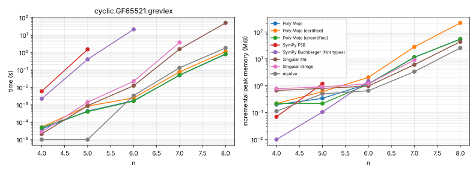
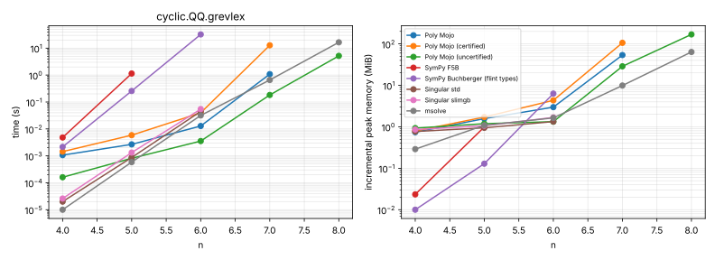
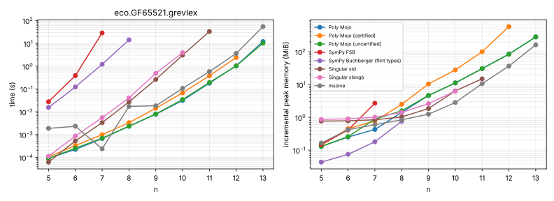
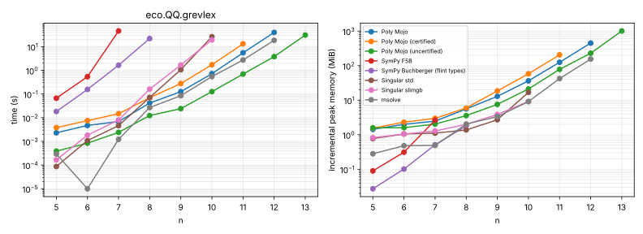
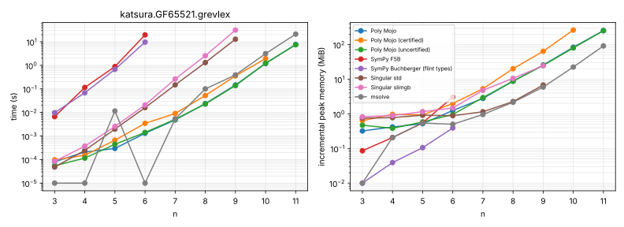
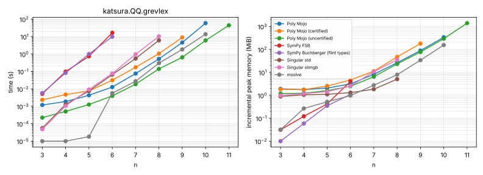
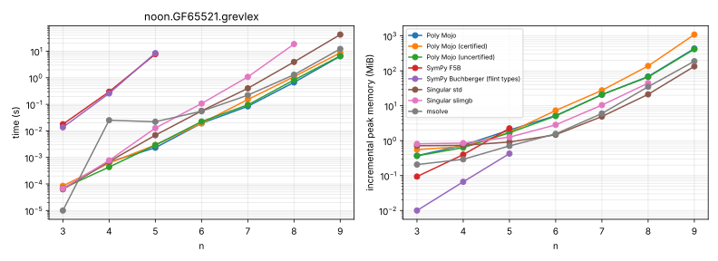
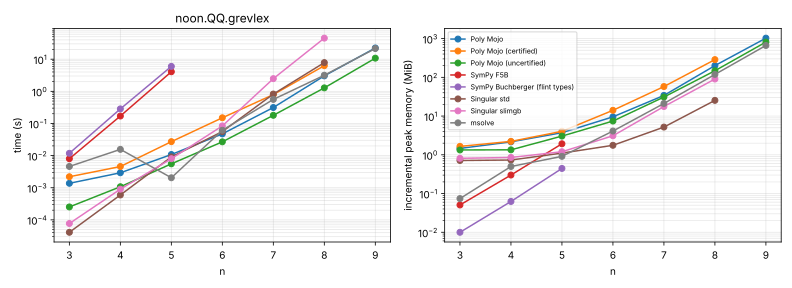
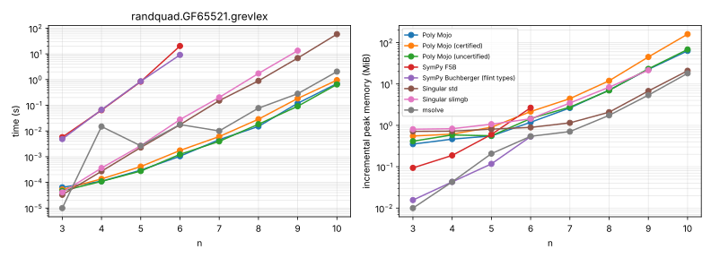
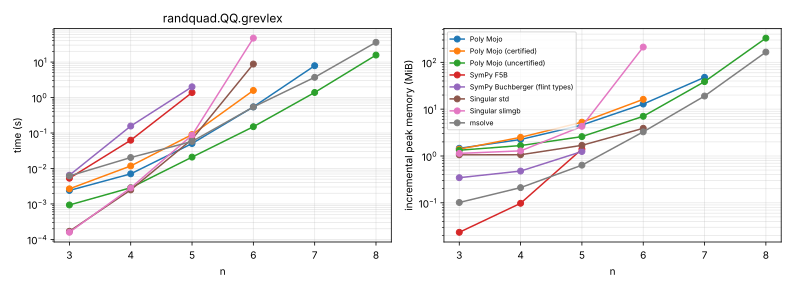
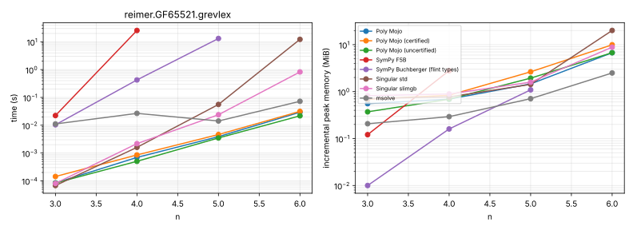
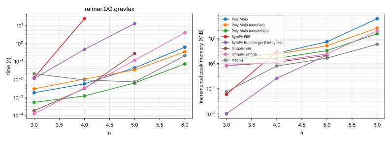
