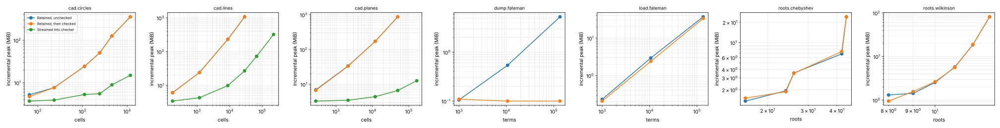

# Streaming study

Host: Intel(R) Xeon(R) Processor @ 2.10GHz, 4 vCPUs, 16 GiB RAM. Runs are pinned to one CPU, capped at 3G and 600 s. Poly Mojo d6549d350302.

Each cell gives wall time and the incremental peak resident memory of the measured work: the high-water mark from just before the call to its end, minus the resident size before it. Both checked routes establish the same claim; the streamed route never holds the complete output.

### CAD of k random lines (`cad.decompose` + `cad.check` against `cad.decompose_to` + `cad.checker`)

| size | cells | Retained, unchecked | Retained, then checked | Streamed into checker | checked peak ÷ streamed peak |
|---|---|---|---|---|---|
| 4 | 177 | 10.1 ms 6.01 MiB | 24.3 ms 6.07 MiB | 23.9 ms 3.41 MiB | 1.78× |
| 8 | 1,185 | 91.2 ms 23.9 MiB | 149 ms 23.9 MiB | 134 ms 4.29 MiB | 5.58× |
| 16 | 8,769 | 1.47 s 231 MiB | 1.99 s 231 MiB | 1.57 s 9.81 MiB | 23.5× |
| 24 | 28,799 | 10.8 s 1.05 GiB | 13.4 s 1.05 GiB | 6.89 s 26.9 MiB | 39.9× |
| 32 | 67,193 | OOM | OOM | 19.8 s 72.5 MiB | checked route: OOM |
| 48 | 223,077 | · | · | 94.6 s 322 MiB | checked route: · |
| 64 |  | · | · | timeout |  |

### CAD of k random circles

| size | cells | Retained, unchecked | Retained, then checked | Streamed into checker | checked peak ÷ streamed peak |
|---|---|---|---|---|---|
| 2 | 65 | 9.45 ms 5.2 MiB | 22.1 ms 4.73 MiB | 24.5 ms 3.7 MiB | 1.28× |
| 4 | 233 | 44.2 ms 7.65 MiB | 77.3 ms 7.65 MiB | 110 ms 3.9 MiB | 1.96× |
| 6 | 1,115 | 256 ms 24.2 MiB | 345 ms 24.4 MiB | 337 ms 5.29 MiB | 4.62× |
| 8 | 2,437 | 593 ms 50.4 MiB | 1.06 s 50.3 MiB | 949 ms 5.51 MiB | 9.13× |
| 12 | 4,571 | 1.71 s 125 MiB | 2.37 s 126 MiB | 2.03 s 8.91 MiB | 14.1× |
| 16 | 11,845 | 5.4 s 354 MiB | 7.84 s 354 MiB | 6.7 s 14.9 MiB | 23.7× |

### CAD of k random planes in three variables

| size | cells | Retained, unchecked | Retained, then checked | Streamed into checker | checked peak ÷ streamed peak |
|---|---|---|---|---|---|
| 2 | 277 | 13.7 ms 6.93 MiB | 22.5 ms 6.71 MiB | 22 ms 3.3 MiB | 2.04× |
| 3 | 2,143 | 111 ms 33.5 MiB | 206 ms 33.1 MiB | 190 ms 3.48 MiB | 9.49× |
| 4 | 11,945 | 708 ms 171 MiB | 1.29 s 172 MiB | 1.18 s 4.4 MiB | 39.1× |
| 5 | 49,831 | 3.43 s 869 MiB | 5.83 s 869 MiB | 5.48 s 6.66 MiB | 131× |
| 6 | 166,357 | OOM | OOM | 21.4 s 12.7 MiB | checked route: OOM |
| 8 |  | · | · | timeout |  |

### Real roots of the Wilkinson polynomial of degree n to 64 bits (`real_root_cover` + `roots.check` against `real_root_cover_to` + checker)

| size | roots | Retained, unchecked | Retained, then checked | Streamed into checker | checked peak ÷ streamed peak |
|---|---|---|---|---|---|
| 50 | 8 | n/a | 3.36 ms 1.31 MiB | 3.33 ms < 1 MiB | 1.38× |
| 100 | 9 | n/a | 18.3 ms 1.43 MiB | 18.6 ms 1.57 MiB | 0.908× |
| 200 | 10 | n/a | 130 ms 2.54 MiB | 126 ms 2.64 MiB | 0.961× |
| 400 | 11 | n/a | 1.09 s 5.74 MiB | 1.09 s 5.61 MiB | 1.02× |
| 800 | 12 | n/a | 10.1 s 18.7 MiB | 10 s 18.9 MiB | 0.986× |
| 1600 | 13 | n/a | 95.4 s 81.2 MiB | 98.5 s 81.3 MiB | 0.998× |

### Real roots of the Chebyshev polynomial T_n to 64 bits

| size | roots | Retained, unchecked | Retained, then checked | Streamed into checker | checked peak ÷ streamed peak |
|---|---|---|---|---|---|
| 100 | 16 | n/a | 31.6 ms 1.36 MiB | 25.7 ms 1.5 MiB | 0.904× |
| 200 | 24 | n/a | 128 ms 1.93 MiB | 128 ms 1.87 MiB | 1.03× |
| 400 | 26 | n/a | 780 ms 3.54 MiB | 788 ms 3.51 MiB | 1.01× |
| 800 | 42 | n/a | 7.58 s 6.81 MiB | 7.68 s 7.38 MiB | 0.923× |
| 1600 | 44 | n/a | 58.8 s 24.1 MiB | 57.3 s 24.1 MiB | 0.999× |
| 3200 |  | n/a | timeout | timeout |  |

### Write (1 + x + y + z + t)^n as text (`sparse.dumps` to a file against `sparse.dump` into a file sink)

| size | terms | Retained, unchecked | Retained, then checked | Streamed into checker | checked peak ÷ streamed peak |
|---|---|---|---|---|---|
| 10 | 1,001 | n/a | < 1 ms < 1 MiB | < 1 ms < 1 MiB | 0.964× |
| 20 | 10,626 | n/a | 5.57 ms < 1 MiB | 5.38 ms < 1 MiB | 6× |
| 40 | 135,751 | n/a | 142 ms 5.28 MiB | 133 ms < 1 MiB | 150× |
| 60 |  | n/a | timeout | timeout |  |
| 80 |  | n/a | · | · |  |

### Read (1 + x + y + z + t)^n back (`sparse.loads` of the whole file against `sparse.load` from a file source)

| size | terms | Retained, unchecked | Retained, then checked | Streamed into checker | checked peak ÷ streamed peak |
|---|---|---|---|---|---|
| 10 | 1,001 | n/a | 1.43 ms < 1 MiB | 1.33 ms < 1 MiB | 1.11× |
| 20 | 10,626 | n/a | 17.1 ms 2.93 MiB | 17.4 ms 2.38 MiB | 1.23× |
| 40 | 135,751 | n/a | 358 ms 37 MiB | 337 ms 33.6 MiB | 1.1× |
| 60 |  | n/a | timeout | timeout |  |
| 80 |  | n/a | · | · |  |

