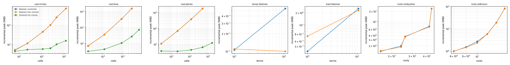

# Streaming study

Host: Intel(R) Xeon(R) Processor @ 2.80GHz, 4 vCPUs, 16 GiB RAM. Runs are pinned to one CPU, capped at 3G and 600 s. Poly Mojo d1f992ffe139.

Run note: to finish within the assessment window, cases after cad-lines-32 ran with a 120 s limit and one process per case (the README's streaming setting); cad-circles 2–16 and cad-lines 4–32 kept 600 s and three processes. Under the 120 s limit, cad-lines-48, cad-planes-8 and roots-chebyshev-3200 time out where the 600 s run of 2026-10-18 finished cad-lines-48 in 502 s. dump-fateman-40 and load-fateman-40 also time out: their input, (1 + x + y + z + t)^40 over QQ, is built untimed before the measured call and takes longer than 120 s on its own; the 600 s run timed the dump itself at 0.12 s.

Each cell gives wall time and the incremental peak resident memory of the measured work: the high-water mark from just before the call to its end, minus the resident size before it. Both checked routes establish the same claim; the streamed route never holds the complete output.

### CAD of k random lines (`cad.decompose` + `cad.check` against `cad.decompose_to` + `cad.checker`)

| size | cells | Retained, unchecked | Retained, then checked | Streamed into checker | checked peak ÷ streamed peak |
|---|---|---|---|---|---|
| 4 | 177 | 16.4 ms 6.98 MiB | 30.1 ms 6.85 MiB | 55.2 ms 3.19 MiB | 2.15× |
| 8 | 1,185 | 155 ms 36 MiB | 242 ms 36.4 MiB | 771 ms 4.3 MiB | 8.47× |
| 16 | 8,769 | 2 s 345 MiB | 2.75 s 345 MiB | 9.04 s 10.5 MiB | 32.7× |
| 24 | 28,799 | 12.2 s 1.51 GiB | 15.8 s 1.51 GiB | 45.7 s 26.8 MiB | 57.6× |
| 32 | 67,193 | OOM | OOM | 140 s 72 MiB | checked route: OOM |
| 48 |  | · | · | timeout |  |
| 64 |  | · | · | · |  |

### CAD of k random circles

| size | cells | Retained, unchecked | Retained, then checked | Streamed into checker | checked peak ÷ streamed peak |
|---|---|---|---|---|---|
| 2 | 65 | 30 ms 5.12 MiB | 40.1 ms 5.33 MiB | 39.7 ms 4.45 MiB | 1.2× |
| 4 | 233 | 125 ms 11.5 MiB | 175 ms 11.5 MiB | 286 ms 5.46 MiB | 2.11× |
| 6 | 1,115 | 690 ms 45.3 MiB | 1.05 s 45.6 MiB | 1.73 s 5.83 MiB | 7.83× |
| 8 | 2,437 | 1.86 s 102 MiB | 2.74 s 102 MiB | 4.72 s 6.41 MiB | 15.9× |
| 12 | 4,571 | 4.41 s 253 MiB | 6.23 s 253 MiB | 13.2 s 10.2 MiB | 24.7× |
| 16 | 11,845 | 17.9 s 723 MiB | 23.2 s 723 MiB | 45 s 15.6 MiB | 46.2× |

### CAD of k random planes in three variables

| size | cells | Retained, unchecked | Retained, then checked | Streamed into checker | checked peak ÷ streamed peak |
|---|---|---|---|---|---|
| 2 | 277 | 34.5 ms 11 MiB | 54.7 ms 10.9 MiB | 95.8 ms 3.77 MiB | 2.89× |
| 3 | 2,143 | 275 ms 69.4 MiB | 401 ms 69.2 MiB | 823 ms 3.61 MiB | 19.2× |
| 4 | 11,945 | 1.54 s 387 MiB | 2.65 s 387 MiB | 5.4 s 4.44 MiB | 87.1× |
| 5 | 49,831 | 6.75 s 1.78 GiB | 11.9 s 1.78 GiB | 27.9 s 6.48 MiB | 281× |
| 6 | 166,357 | OOM | OOM | 112 s 12.3 MiB | checked route: OOM |
| 8 |  | · | · | timeout |  |

### Real roots of the Wilkinson polynomial of degree n to 64 bits (`real_root_cover` + `roots.check` against `real_root_cover_to` + checker)

| size | roots | Retained, unchecked | Retained, then checked | Streamed into checker | checked peak ÷ streamed peak |
|---|---|---|---|---|---|
| 50 | 8 | n/a | 4.03 ms < 1 MiB | 3.35 ms < 1 MiB | 0.976× |
| 100 | 9 | n/a | 31.4 ms 1.52 MiB | 27.1 ms 1.46 MiB | 1.05× |
| 200 | 10 | n/a | 165 ms 2.68 MiB | 156 ms 2.31 MiB | 1.16× |
| 400 | 11 | n/a | 1.39 s 5.73 MiB | 1.39 s 5.84 MiB | 0.983× |
| 800 | 12 | n/a | 10.6 s 18.8 MiB | 10.6 s 19 MiB | 0.987× |
| 1600 | 13 | n/a | 95.4 s 81.3 MiB | 97.8 s 81.2 MiB | 1× |

### Real roots of the Chebyshev polynomial T_n to 64 bits

| size | roots | Retained, unchecked | Retained, then checked | Streamed into checker | checked peak ÷ streamed peak |
|---|---|---|---|---|---|
| 100 | 16 | n/a | 31 ms 1.38 MiB | 29.9 ms 1.43 MiB | 0.97× |
| 200 | 24 | n/a | 142 ms 1.98 MiB | 146 ms 1.85 MiB | 1.07× |
| 400 | 26 | n/a | 836 ms 3.66 MiB | 751 ms 3.74 MiB | 0.977× |
| 800 | 42 | n/a | 8.06 s 7.32 MiB | 8.44 s 7.07 MiB | 1.04× |
| 1600 | 44 | n/a | 64.9 s 23.9 MiB | 62.7 s 24.1 MiB | 0.991× |
| 3200 |  | n/a | timeout | timeout |  |

### Write (1 + x + y + z + t)^n as text (`sparse.dumps` to a file against `sparse.dump` into a file sink)

| size | terms | Retained, unchecked | Retained, then checked | Streamed into checker | checked peak ÷ streamed peak |
|---|---|---|---|---|---|
| 10 | 1,001 | n/a | 1.09 ms < 1 MiB | 1.17 ms < 1 MiB | 0.964× |
| 20 | 10,626 | n/a | 5.81 ms < 1 MiB | 7.05 ms < 1 MiB | 6.23× |
| 40 |  | n/a | timeout | timeout |  |
| 60 |  | n/a | · | · |  |
| 80 |  | n/a | · | · |  |

### Read (1 + x + y + z + t)^n back (`sparse.loads` of the whole file against `sparse.load` from a file source)

| size | terms | Retained, unchecked | Retained, then checked | Streamed into checker | checked peak ÷ streamed peak |
|---|---|---|---|---|---|
| 10 | 1,001 | n/a | 1.65 ms < 1 MiB | 1.8 ms < 1 MiB | 0.423× |
| 20 | 10,626 | n/a | 18.5 ms 2.55 MiB | 19.7 ms 2.28 MiB | 1.12× |
| 40 |  | n/a | timeout | timeout |  |
| 60 |  | n/a | · | · |  |
| 80 |  | n/a | · | · |  |

